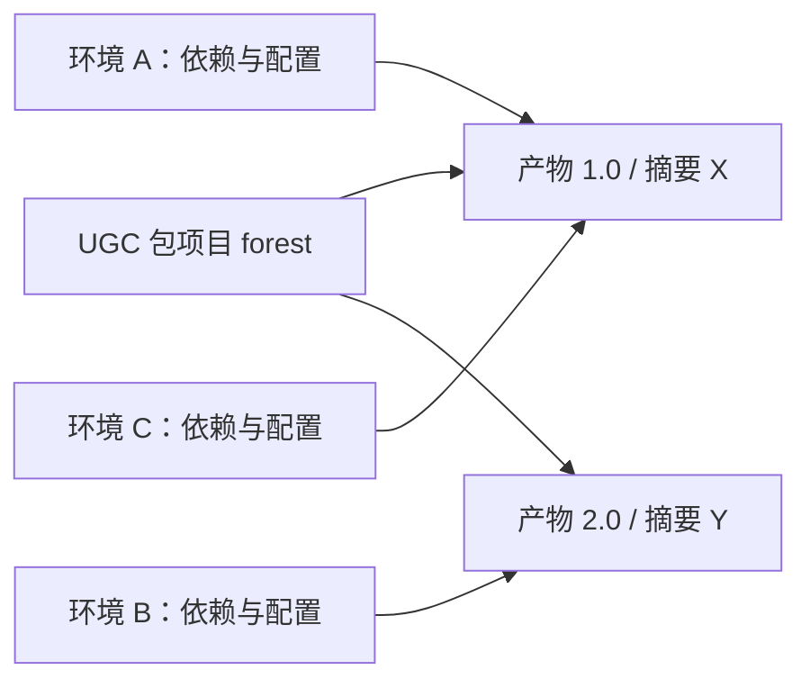

# UGC 开发单元与环境依赖管理

日期：2026-11-17。状态：已实施主要页面和依赖语义；后续项仍以文末范围说明为准。产品方向按本次用户澄清调整：内容包管理以 UGC 开发单元为核心；模组组合管理放在环境内；环境修改归结为依赖修改与配置修改。

## 设计结论

内容包回答“我开发和交付什么”，环境回答“这套对战使用哪些内容、怎样配置”。共享材料存储是支撑两者的实现细节，不作为另一套主要业务管理对象。

因此撤回将“已安装包库”作为内容包页中心、强制先到包库安装再到环境加入、为包库新增完整顶层管理体系的初稿方向。保留现有每环境 npm 项目、声明、锁文件和成功应用后刷新运行内容的基础，不为新页面重写解析器。

## 调研及采用范围

| 参考项目  | 官方资料确认的做法                                                                                               | 本项目采用的思路                                        |
| --------- | ---------------------------------------------------------------------------------------------------------------- | ------------------------------------------------------- |
| Unity UPM | 项目清单管理直接依赖；包本身的清单声明包的依赖；解析完整依赖图并锁定。注册表包不可直接编辑，开发包另有可编辑来源 | 分开包开发与环境消费；环境是依赖编辑的主体              |
| npm       | package-lock 记录精确依赖树                                                                                      | 环境声明表达要求，锁文件记录实际组合                    |
| uv        | 已发布新版本不会自行使锁过期；显式升级与普通同步分离                                                             | 修改规则或重新启动不应顺便升级内容                      |
| pnpm      | 不可变文件可以共享，但相同版本在不同 peer 组合下需要不同依赖布局                                                 | 共享原始材料，环境独立解析；不共享全局可变 node_modules |
| Conda     | 环境可使用不同包版本；环境目录和下载缓存分离，按条件硬链接或复制                                                 | 多环境版本隔离无需用户手工维护多个包库                  |
| Modrinth  | 内容可跨实例去重，存储清理单独提供                                                                               | 存储维护降为高级工具，不成为创作主流程                  |

Unity 只作为职责分工参考，不照搬其版本选择算法、可变目录覆盖机制或脚本执行行为。Arcadia 继续遵守严格内容依赖、静态准备和宿主执行政策。

资料于 2026-11-17 查阅：

- [Unity 项目清单](https://docs.unity.com/en-us/engine/6000.0/manual/packages-list/managing-packages-manifest/upm-manifest-prj)
- [Unity 包依赖与解析](https://docs.unity.com/en-us/engine/6000.0/manual/packages-list/dependencies-lp/upm-dependencies)
- [Unity 可编辑开发包与不可变缓存](https://docs.unity.com/en-us/engine/6000.0/manual/packages-list/dependencies-lp/upm-embed)
- [npm 锁文件](https://docs.npmjs.com/cli/v11/configuring-npm/package-lock-json/)
- [uv 锁定与同步](https://docs.astral.sh/uv/concepts/projects/sync/)
- [pnpm 安装布局](https://pnpm.io/symlinked-node-modules-structure)、[peer 解析](https://pnpm.io/how-peers-are-resolved)
- [Conda 环境管理](https://docs.conda.io/projects/conda/en/latest/user-guide/tasks/manage-environments.html)、[环境与缓存](https://docs.conda.io/projects/conda/en/latest/user-guide/configuration/custom-env-and-pkg-locations.html)
- [Modrinth 共享存储](https://modrinth.com/news/changelog/app/0.21.0)

## 对象与所有权

| 对象           | 管理内容                                           | 不应混入的内容                       |
| -------------- | -------------------------------------------------- | ------------------------------------ |
| 内容包项目     | 包身份、内容源码、资源、包自身依赖、构建和试战     | 某服务器是否开放、所有环境的版本选择 |
| 包版本产物     | 构建出的不可变内容、版本、来源、摘要               | 可直接编辑的源项目状态               |
| 环境           | 直接依赖要求、来源、锁定结果、环境规则及支持的配置 | 包源码、全局启用开关                 |
| 服务器使用关系 | 开放、匹配、默认和执行策略                         | 环境依赖清单的另一份副本             |
| 材料存储       | 下载复用、完整性、持有和清理                       | 第二套权威环境成员表                 |

包项目与环境都可以有 dependencies，但所属对象不同。例如 weather 包要求 forest ^1，这是作者声明的包依赖；环境 A 直接选择 weather 1.3，则 forest 是环境的自动依赖。修改环境 A 不能回写 weather 产物中的 package.json。

包配置指构建或声明内容的开发信息。环境配置指对该组合生效的运行规则；若包提供可配置项，环境只保存按该版本 schema 验证的配置值，不直接改包文件。当前未提供通用配置 schema 的包不能被界面假装支持任意配置。

## 信息架构与交互

沿用内容中心单入口，包含“内容包”和“环境”。建议页面标题保留现有术语，内容包页内部以“项目”组织。顶层位置/权限只展示实际支持的能力，远程服务器管理员身份不代表有本机源码编辑权限。

内容包页：

- 主列表展示可管理的 UGC 项目、版本、最近构建状态。
- 主要操作是新建、打开、编辑、校验、构建、试战、导出产物；复用现有作者工作区。
- 版本详情列出构建产物，可“用于环境”，选择目标后进入环境依赖变更。
- 将“安装此版本”改为面向目标的“用于环境”，不先改变全局选择。若当前后端仅提供本地构建/打包，就只展示这些能力，不凭空增加在线发布系统。
- 已安装/下载的第三方材料不是可编辑项目。查看它们从环境依赖详情进入；编辑需明确打开源码或创建可编辑副本，不能写共享缓存。
- “从项目列表移除”只取消登记，不删除源文件、不移除环境依赖。删除源码目录属于单独的文件操作。

环境页：

- 主要编辑区为“依赖”和“配置”，保留导入、导出、复制、本地使用及服务器使用关系。
- 依赖列表展示包名、要求版本/来源、实际版本、直接/自动依赖状态。自动依赖可以折叠，详情显示由谁引入。
- 操作是“加入环境”“更换版本”“移出环境”；更新解析独立于普通保存。
- 新增依赖可选择注册表版本、归档或本地构建产物；获取缺少材料作为应用步骤完成，不要求先去独立包库安装。
- 编辑依赖和配置形成同一份候选改动，以“保存并应用”提交；快捷加入/移出复用相同应用流程。有未保存修改时先合并进当前候选，不能悄悄基于旧文档立即应用。
- 不增加永久“已移出”区。移出即删除该依赖要求，后续从来源重新加入。

不要将“保存编辑”与“立即影响现有对局”混为一谈；已有对局持有原内容，新对局使用成功应用的组合。

## 多版本和配置隔离

- 不同环境可以引用不同第三方包版本；A 和 C 也可以复用相同材料，但具有不同规则。
- 每个环境拥有自己的声明和锁文件；一环境内同名内容包、同内容身份、同 namespace 只允许一个实例。普通 JavaScript 工具库仍可使用 npm 多版本树。
- 版本范围是要求，锁文件才是实际结果。普通应用保留仍满足约束的锁定版本；显式更新才查找新版本。连带变化应显示在依赖差异中。
- 同版本不同 peer 组合分别准备安装布局。缓存身份包含完整依赖图、内容摘要、准备器/引擎及相关平台条件，不只使用 name@version。
- 同名同版本同材料可复用；同名同版本不同材料不覆盖原物，默认提示版本冲突。开发试战可用隔离的构建产物摘要区分同版本多次构建；正式发布应递增版本。
- 内容、规则、资源和包配置都从同一次环境捕获读取，不使用一个按包名覆盖的全局运行注册表。
- 移出直接成员后，仍被其他成员需要的依赖保留。若要完全移出被依赖的包，需要明确连带移出依赖方；如果只删除直接声明而仍作为间接依赖留下，操作应明确叫“改为自动依赖”。

## 作者开发与环境使用衔接

源项目保存 → 校验/构建 → 得到确定产物 → 选择试战或用于环境。

日常源文件保存不改变正式环境。试战沿用独立预览生命周期，捕获本次构建和调试配置；“用于环境”显式替换目标依赖并应用。第一阶段不增加会随源码修改自动变化的正式环境链接。

把本地开发包放入可分享环境时，必须捕获产物及依赖，或提供可获取的确切来源和摘要。不能把本机目录绝对路径当作接收方可用的依赖，也不能导出一个未完成构建的可变源码引用冒充发行包。

删除开发项目不应破坏已捕获产物的环境；移出环境也不删除开发项目。两者通过产物相连。

## 官方基础包与宿主

保持当前已经明确的策略：程序附带基础包随客户端/服务器更新自动同步，已有环境不能用旧版本声明阻止同步。它与第三方包显式更新不同。

环境显示基础包实际版本及“随程序更新”，不提供任意旧版本选择。相同版本号但字节不同也必须通过摘要识别，旧运行中内容不可原地覆盖。第三方锁定结果不随基础包同步顺便升级，不新增旧基础包兼容阻拦。

导出记录实际基础包和宿主信息；导入另一宿主时若按宿主策略替换基础包，报告此差异，不声称完全相同的还原。任意旧基础包并存需要另行改变产品策略，本次不默认引入。

## 应用、权限与材料维护

应用过程：解析候选依赖与配置 → 获取缺少材料 → 隔离准备并校验 → 检查权限与修订 → 提交 → 刷新使用关系。失败保留原可用环境；获取成功而应用失败的材料可复用。

内容项目写入、环境编辑/准备、服务器使用和代码执行分别授权。准备仍不运行 npm 生命周期脚本或作者模块；官方服务仍不执行第三方维护代码。桌面与 HTTP 复用已有服务契约，远程窗口没有本地文件权限。

环境已提交但某服务器加载失败时分别报告两个状态，保留旧运行实例，允许重试加载。不要宣称跨工作区、数据库、进程的原子提交。

材料共享范围是一个工作区及其写所有者，不默认跨主机共享磁盘。保持桌面私有桥单写所有者；独立服务器获取自己的材料。环境声明/锁文件在工作区，数据库仍只管理权限、绑定、任务和审计。

存储维护置于高级工具：清理未使用下载、修复缺失材料、查看占用。清理不删除源码、当前环境必需材料、准备中任务或运行租约引用。可重新下载的缓存与唯一的本地归档必须区分：本地唯一材料在仍被引用时不得删除，重启后从权威文件重建持有关系。

第一阶段保留现有环境复制材料的实现；不以去重为由切换包管理器或放宽 pack-loader 的符号链接/不可变性检查。以后可复用只读材料、文件系统克隆或复制回退，不能直接把多个环境连到同一个可变 node_modules。

## 现有代码与实施切分

当前已具备：

- `packages/web-ui/src/features/authoring/`：作者工作区、内容编辑和预览。
- `ContentPackagesPanel.vue`：本地项目与已安装包混在同一页面，适合按职责重新组织。
- `EnvironmentWorkspace.vue`：共享环境视图，已有依赖成员、规则和应用操作。
- `packages/content-dev/src/content-workspace.ts`：环境权威文件、准备/提交及租约。
- `managed-projects.ts`：获取、锁定、基础包同步。
- Electron `content-library.mjs`：当前“安装项目”粒度的材料管理，可留作过渡实现，不能当作完整的新领域模型。

建议实施顺序：

1. 固化本文对象关系，更新正式术语。以共享测试明确源项目、产物、环境修改互不隐式传播。
2. 重组内容页：以项目为中心复用作者工作区；依赖的安装、版本选择和移出归入环境。消除两处相似“配置”的歧义。
3. 统一环境候选编辑与应用，新增包、规则修改和快捷操作共用服务。保留 packages/add/remove 名称；add 要求明确来源/版本，不再从 disabled 隐式恢复；remove 停止写入 disabled。CLI、桌面桥、HTTP 同步更新。
4. 构建产物“用于环境”连接作者和消费流程，支持不同环境选不同版本，并验证预览隔离。
5. 迁移旧 disabled：先备份原环境文档，再从当前权威声明中删除该字段；备份仅供迁移恢复，不成为永久 UI 状态。不改其他依赖和锁、不重新解析升级。
6. 现有安装材料继续供环境使用；旧包库页面退入环境来源选择或高级材料维护，不把缓存条目自动当作源码项目。材料索引和物理去重单独优化。

协议变更需标明能力/格式差异，旧客户端不能继续假设无声明 add 可以恢复。迁移保持可重复、可中断恢复；未完成迁移不得破坏旧环境。正式文档在实现对应阶段更新，当前提案不表示功能已完成。

## 验收重点

- 同一 UGC 项目的两个发行版本分别被两个环境使用，同时开局不串内容和配置。
- 编辑源项目、构建新产物，不改变正式环境；用于 A 不改变 B；删除项目登记不破坏已有环境。
- 直接依赖、自动依赖、版本范围和实际版本清楚；依赖冲突返回完整原因。
- 移出后无 disabled 残留，共享依赖按剩余根重新确定；编辑未保存时快捷操作不会覆盖候选修改。
- 改配置不升级依赖，检查更新不自动应用，构建/下载不等于运行第三方代码。
- 权限撤销、并发修订、离线缺包、获取成功但准备失败、环境成功但绑定加载失败分别准确处理。
- 导入导出捕获产物而非源码路径；唯一的本地材料不被缓存清理误删。
- 基础包自动同步及已有房间内容捕获保持现有策略。

## 本次实施范围

已落地：UGC 项目入口、环境依赖/配置编辑、已有版本及归档选择、构建产物选择目标环境、移出不留历史、旧全局选择迁移后清理、旧环境声明改写前归档、npm 管线保留。现有材料维护退入环境的“内容来源”。

未引入：新的在线发布服务、通用包配置 schema、独立更新预览流程、物理存储去重、正式环境源码热链接。现有保存并应用和服务器绑定机制继续沿用。
