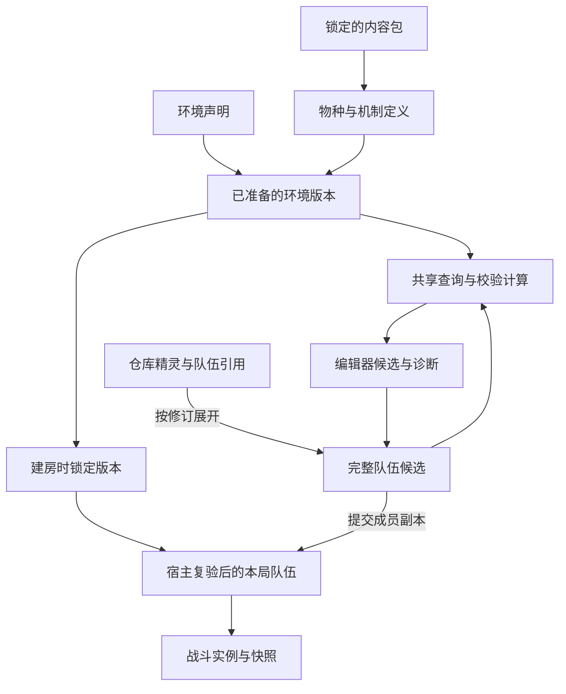

# 环境、数值机制与仓库组队系统改造设计

日期：2026-11-18（初稿 2026-11-17）。规则组合、属性相克、技能参数与队伍准入已接入各宿主。本文细化[需求与完整设计](environment-system-design.md)中的规则与运行契约，补充[环境依赖与配置模型](content-environment-model.md)。范围包括养成规格、机制选择、规则组合、队伍存储与编辑，不建设竞技分级、使用率或升降级系统。

## 改造定位与交付范围

本项是环境系统、数值机制、仓库组队数据及编辑入口的联合改造。遗传功能和两个官方环境是首批应用实例；接口、存储与校验必须适用于用户和社区定义的任意可支持环境。不能以官方环境名称、来源或两个固定 ID 分支决定玩法。

| 改造面             | 本轮交付职责                                                   | 完成判据                                                   |
| ------------------ | -------------------------------------------------------------- | ---------------------------------------------------------- |
| 环境系统           | 作者编辑依赖和规则选择，工作区锁定材料并准备有效规格           | 任意符合契约的环境均走同一解析、版本身份与绑定链路         |
| 数值机制           | 将种族、个体、性格、养成修正、顺序与取整收敛到共享计算契约     | 编辑预览、仓库详情、开局、重算与恢复使用一致依据           |
| 仓库与组队         | 可保存的草稿格式、稳定身份、队伍成员关系、迁移、导入导出与恢复 | 跨环境保留完整选择，保存失败不破坏旧数据，非法配置不能参战 |
| 编辑与展示         | 根据环境查询候选、范围、资格、属性和诊断                       | 自定义环境无需复制一套编辑器；缺内容与未支持机制可定位     |
| 宿主与对战生命周期 | 权威准入、环境捕获、运行能力及快照兼容                         | 各入口不能绕过校验，既有对局不读取变化中的环境             |

沿用现有内容工作区所有权、包依赖解析、不可变准备产物和服务器绑定职责，在其契约上扩展机制配置；原生战斗阶段处理与内容执行政策继续保持。数值共享层必须覆盖运行时调用，不能只抽取页面公式；仓库迁移必须覆盖档案与备份，不能只放宽输入框。

### 自定义环境是一等使用场景

环境选择来自当前可访问的环境集合，支持本地、作者预览及服务器提供的上下文。官方基础环境只是首次使用的默认选择；环境缺失或解析失败时保留原引用并显示未解析，不自动用基础环境替代。来源权限与运行授权沿用现有宿主政策。

范围、性格集合、遗传来源、强化策略和队伍容量均查询解析规格。静态定义与既有计算操作能表达的环境无需修改页面；新计算或槽位机制通过版本化宿主实现扩展，未知能力明确拒绝。用户环境可以独立定义规则，也可复用任意合法规则集，不要求继承官方基础环境。

仓库、队伍和精灵不按官方／社区或基础／测试永久分类。可用性是相对具体环境版本的计算结果；环境删除、离线或依赖缺失不删除玩家配置。

### 分阶段贯通，而非各系统独立替换

先固定环境规格、草稿与计算契约，接通保留当前 31 行为的完整链路；迁移存储并让各入口共同调用新契约。随后接入遗传资格与技能，再用官方扩展测试环境验证 120 与强化。每一步都验证保存、编辑、宿主准入及运行计算，避免先发布新格式却留下旧导入器或旧属性计算路径。

迁移完成后，新旧入口收敛到同一校验与计算实现。兼容层只转换旧数据；不得长期维护仓库、编辑器、服务器各自解释机制的路径。范围内改造不意味着重写与这些职责无关的数据库、账号或包管理系统。

## 1. 核心关系与所有权

内容包提供物种、技能与机制定义。作者在环境声明中选择依赖和规则，工作区准备出可供使用的版本。个人仓库保存精灵配法，队伍引用成员。编辑器按入口取得的版本预览这些选择，宿主按本局版本复验。

| 对象             | 权威内容                                                                         | 不承担的职责                             |
| ---------------- | -------------------------------------------------------------------------------- | ---------------------------------------- |
| 精灵物种定义     | 种族值、普通学习池、遗传资格与池、特性／纹章、强化资格                           | 玩家个体值、当前环境开关、玩家选中的技能 |
| 机制内容定义     | 普通与二代性格修正、战斗属性和具名相克表、神魔化方案、计算规格引用、可复用规则集 | 任意脚本自动执行、全局环境选择           |
| 环境声明         | 包依赖、机制参数、可选规则集、准入限制                                           | 回写物种定义、永久修改玩家队伍           |
| 已准备的环境版本 | 固定内容目录、生效参数与规则、实现版本要求、来源与身份                           | 可变全局状态                             |
| 个人仓库精灵     | 一只精灵的一套完整选择，包括物种、个体、性格、技能和强化方案                     | 自证遗传资格、权威最终属性、可信校验结果 |
| 个人队伍         | 有序的仓库精灵实例引用及可选的查看环境偏好                                       | 已准备的材料、房间版本锁                 |
| 本局队伍         | 按房间锁定的版本或本次离线试战的已准备版本验证、派生后的有效配置与计算输入       | 回写草稿、跨环境直接复用                 |
| 战斗实例         | 动态体力、状态、变身和本局计算上下文                                             | 重新读取环境最新设置                     |
| 编辑器           | 展示候选、修改草稿、显示预览和问题                                               | 自行实现资格判断或另一份属性公式         |



环境仍是唯一玩法选择入口。规则集是可选的配置复用，不增加必须先创建的赛制对象。前期／后期可以做预设，具体功能独立选择。每个已准备版本对应一套确定配置。服务器绑定管理开放与匹配，同名环境的不同房间可以持有不同版本。

### 首批环境：基础与扩展测试

本轮确定两个独立的官方环境实例；环境数量与来源不受此表限制。基础环境仅新增遗传相关功能；额外提供扩展测试环境，验证同一模型能切换养成规格。

| 配置               | 基础环境                   | 扩展测试环境                             |
| ------------------ | -------------------------- | ---------------------------------------- |
| 六项个体值         | 每项 0–31                  | 每项 0–120，无额外总和预算               |
| 遗传技能           | 有资格物种从有效池选择一个 | 沿用基础环境资格、池与数量               |
| 二代性格           | 仅支持遗传的物种开放       | 沿用相同资格                             |
| 神魔化             | forbidden，不提供新选入口  | active，按已定义资格选择方案和阶段       |
| 其他配队与战斗规则 | 保持基础规则               | 复用同一版本基础规则，仅明确覆盖上述差异 |
| 默认入口           | 保持基础环境               | 用户显式选择，不替换基础环境或其绑定     |

测试环境复用基础规则集和共同内容定义，不复制一份物种数据，也不读取正在变化的基础环境作为运行时父对象。准备时锁定依赖版本，展开覆盖得到独立环境身份；基础规则更新后，测试环境经重新准备与校验才采用新版本。神魔化定义可由额外测试内容提供，基础环境不因该内容已安装而开放机制。

测试环境用于验证扩展契约，尚未核实的原作计算可以采用明确命名、固定顺序的实验规格，但必须记录假设和版本，不标为准确原作复刻。缺失实现或必要定义时仍不能开局；测试身份不豁免资格、合法性或宿主执行政策。阶段范围以本次实际交付定义为准，不因表中存在圣／冥阶段就自动全部开放。

基础环境可以先完成遗传接入，扩展测试环境随后接入 120 与神魔化；测试功能的完成不作为基础环境新增遗传功能的发布前提。已有捕获环境和历史队伍按原兼容规则处理，不在升级时静默开启新机制。

## 2. 四个养成系统的统一模型

原作与官方默认规则：前期个体上限 31，后期六项分别为 0–120；二代性格两增两减，仅支持遗传系统的精灵可选；有资格的精灵可以从遗传池选择一个技能；神魔化主要提升属性。

| 系统   | 物种／机制定义提供         | 环境决定                     | 队伍保存                 |
| ------ | -------------------------- | ---------------------------- | ------------------------ |
| 个体值 | 计算规格定义               | 各项范围、可选总和预算       | 六项整数                 |
| 性格   | 性格 ID、修正、资格要求    | 可用性格集合                 | 一个性格 ID              |
| 遗传   | 物种资格、技能池及学习条件 | 来源是否开放、数量及槽位规格 | 选定遗传技能与已装备技能 |
| 神魔化 | 可用方案、修正、资格和阶段 | 生效策略与允许方案           | 玩家选定方案及适用阶段   |

### 环境内的资格与学习池调整

内容包提供物种的默认遗传资格、普通学习表和遗传池。官方基础及扩展测试环境均沿用这些默认值。自定义环境可以声明局部调整，在准备时为该版本生成有效物种资料。调整以内容目录中的物种／形态 ID 为目标，对该环境中所有同种仓库精灵生效；进化链联动需显式选择多个形态。仓库实例只保存玩家的实际选择。

**适用对象**分别在「二代性格」和「遗传技能」设置，取值为按物种默认、全部物种、指定物种集合。每项还有独立的开放开关。二代性格可选条件为性格集合开放且命中其适用对象。遗传可选条件为来源开放、命中其适用对象且技能满足有效遗传池的学习条件。两项都按本环境锁定目录解释“全部”，其他精灵禁令和队伍准入仍然有效。

**池从哪里来**单独设置。默认沿用各物种自己的遗传池。作者可选一个公共技能集合，仅给原池为空的物种兜底，或给所有适用物种追加该集合；需要大家完全相同时可显式选“统一使用公共池”。最后叠加逐物种增减。只开放资格时，空池仍为空；预览列出“有资格但无候选”的物种，区分已知空池与引用的集合或技能缺失（后者准备报错）。遗传数量与装备槽继续独立校验。

**逐物种增减技能**在环境的「配招 → 物种技能调整」中选择物种、普通／遗传来源、操作和技能。普通学习条目可带学习等级，未设条件的新增条目标为无等级门槛。移除某来源时移除该物种该来源的所有匹配学习条目。若要这只物种无论通过什么来源都不能装备该招，使用单宠作用域的“物种＋技能”组合禁令。编辑页预览有效普通池、遗传池、学习条件及每项变更的规则来源。

| 目标                             | 环境配置示例                                                 | 应看到的结果                                                              |
| -------------------------------- | ------------------------------------------------------------ | ------------------------------------------------------------------------- |
| 所有物种可选二代性格，按原作遗传 | 二代性格选“全部”，遗传来源选“按物种默认”                     | 原本无资格的物种能选二代性格，其遗传技能候选不变                          |
| 所有物种都能遗传一招             | 遗传选“全部”、名额 1、空池使用非空公共集合；二代性格维持默认 | 已有池的从自身池选，原本空池的从公共池选，其他规则仍参与校验              |
| 只改迪兰特                       | 普通来源新增招 A、移除招 B                                   | 其他物种及其他环境不变。B 若仅剩遗传来源，需选 B 为遗传结果并占用相应名额 |

**合成顺序**为锁定目录 → 解析两个机制的适用对象与池策略 → 应用逐物种学习表调整 → 解析玩家装备的全部可用来源 → 单宠及全队准入。调整以具名规则记录；同一物种、来源和技能出现相反操作或不同新增条件时必须显式解决，不靠作者填写顺序。未知引用准备失败，调整记录及解析依据计入玩法版本。队伍编辑器、房间准入及创建战斗均读取同一有效资料；返回基础环境时保留超出基础规则的原选择供修正。

### 个体与性格

31／120 使用同一个六维结构，120 允许六项同时为 120，不新增总和限制。范围上限、输入默认值和计算公式分别定义；改变上限不自动填满，也不自动改变公式。

性格采用内容 ID 和各项修正定义。二代性格是一个完整性格，不是两个普通性格叠加，也不默认允许任意挑选四项。普通、二代集合可以分别开放。本轮已找到客户端二代性格的 1.1／0.9 倍率与名称表，但存在一个数组尾部异常；完整原作预设仍需核实异常及服务器计算顺序。详见[原作与配队工具调研](environment-reference-research.md)。

### 基础包中的性格与战斗属性

官方基础包发布三类静态定义。普通性格保留现有 25 个条目的身份映射、名称和六项倍率，二代性格沿用同一结构并按集合管理。战斗属性定义水、火、草等属性的稳定 ID、名称和展示资源。具名相克表单独保存“攻击技能属性 × 防守精灵属性”的倍率。官方表完整收录现有 23 × 23 格，包括免疫的 0 和 0.75、1.25 等倍率。体力、攻击等六维继续作为计算契约的固定输入。

#### 相克表合成与单格编辑

基础和 120 测试环境均选用官方基础表。环境作者可以换用另一张具名基础表，也可以沿用原表，只声明少数格子的变化。一个格子由两个带包命名空间的属性 ID 定位，顺序为攻击方、守方。

**随属性生效的关系。** 包作者在新属性的静态定义中分别声明它攻击其他属性、其他属性攻击它的默认倍率。只要该包进入环境的锁定依赖并准备成功，这些关系就随属性生效，包括间接依赖带入的属性。反复引用同一份锁定内容只收集一次。仅下载到本地的包不参与该环境的计算。每条默认关系至少一端属于声明它的包。例如晶属性包可同时定义晶攻火和火攻晶；要改水攻火这类两端均属其他包的格子，作者可提供一个可选的平衡规则集，由环境显式采用。

跨包引用使用完整属性 ID。与必需依赖之间的关系可直接声明。两个可独立使用的包若已知对方，可把交叉格声明为“对方包也在此环境时生效”。此条件只检查锁定包集合，不会自动引入对方。条件命中后，目标属性 ID 必须能解析。第三方也可将双方作为依赖，提供可选的兼容规则集。

| 一格倍率的取值顺序              | 生效条件                                                                                                                                       |
| ------------------------------- | ---------------------------------------------------------------------------------------------------------------------------------------------- |
| 1. 环境对本格的显式值           | 可以用 0 设置免疫，也可以用 1 把继承的克制关系改为普通效果                                                                                     |
| 2. 环境引用的规则集对本格的调整 | 按既有规则集继承关系逐格合并。不相交的格子并存；并列来源对同格给出相同倍率时保留各来源，给出不同倍率时列出冲突，须在上层为该格明确取值才能准备 |
| 3. 包随属性声明的默认关系       | 单一来源直接采用。同方向同值合并并保留来源，同方向异值列出冲突。上面两层有明确生效值时采用该值，否则候选环境无法应用                           |
| 4. 所选基础表中的本格           | 采用原攻防方向的值，包括显式的 0                                                                                                               |
| 5. 已知属性之间的缺省值         | 双方都已定义且以上各层都没有该格时取 1 倍。此默认属于版本化规则                                                                                |

例如甲包的晶属性可以声明“晶攻火 0.5”，乙包的音属性可以声明“音攻水 2”。这两条均不能推出晶与音的关系。两包一起使用时，晶攻音、音攻晶各取 1。兼容规则集若指定晶攻音为 2，反方向仍取 1。环境作者可再把晶攻音改为 0；删除该条环境覆盖后，恢复规则集给出的 2。若同时移除兼容规则集，则该格回到 1。

**环境编辑器。** 在“战斗规则 → 属性相克”选择基础表，按攻击行、防守列查看有效倍率。点一格即可查看生效值和来源，并选择“修改倍率”或“恢复继承”。恢复继承删除本地记录，显式填 1 则将该格固定为 1。加包预览列出新增关系与冲突。若甲包给“晶攻音”设 2，乙包给同格设 0.5，冲突格列出双方包名、锁定版本和倍率。作者可点选其中一个倍率或输入新值，保存为该环境的单格固定值。恢复继承时重新合成，仍有分歧就再次提示。未解决时保留草稿。服务器绑定继续向新房提供上次成功加载的版本，各个已有房间继续使用自己建房时取得的表。环境文档保存依赖、表与可选规则集引用及本地覆盖，包自带关系由锁定材料还原。准备阶段生成本环境只读的有效表供预览、宿主和房间使用。重新准备时，未覆盖的格子随所选依赖版本更新。

同一声明内重复写一格、引用缺失属性或使用负数及非有限倍率均须报错。缺失属性要报告来源和攻防方向；中性默认仅适用于两个已知属性。准备时将相克配置、锁定内容及合成规则版本计入玩法版本标识，加载顺序不能决定交叉格。官方基础表仍以全部 529 格做迁移验收。

物种和技能各自引用属性 ID。战斗按技能的当前攻击属性和目标的当前防守属性查询有效表，同属性攻击加成、效果修改与取整仍由引擎按既有顺序处理。图鉴和战斗相克提示查询该环境的基础倍率，伤害还需计入当次战斗修正。玩家在同一性格栏选择一个性格 ID；属性标签和相克倍率随物种、技能与环境显示。个人组队可另选已准备版本，用原队重新预览它的相克表。房间内查看同一队时始终显示本房的表。来源包暂时缺失时保留草稿 ID，缺失的数值显示无法计算。迁移落点和等价性验收见[实施计划](environment-implementation-plan.md#现有性格和战斗属性迁入基础包)。

### 技能来源与槽位

学习资格、学习结果和战斗装备分别建模：物种给出池，队伍记录选择，环境控制来源与槽位。遗传技能的选择不自动增加战斗技能槽。

队伍只保存一份已装备技能列表，另保存至多一个选定遗传技能。遗传选择是否必须装备、占普通槽还是独立槽，由确认后的槽位规格定义；两者通过一致性校验关联，不能形成两份互相矛盾的已装备列表。

宿主根据物种与环境求出每个技能的合法来源，不信任提交者填写的来源。技能同时能普通学习和遗传时，普通学习条件满足则可按普通来源装备，不因遗传关闭误禁；仅能通过遗传获得的技能必须匹配所选遗传技能。原作是否允许“选了但未装备”尚待查证。

多个技能、来源限额和互斥关系作为整体校验，不对每个技能独立放行。未来多来源或多个遗传名额需要确定的来源分配算法；不能依赖技能排序或贪心选择导致相同队伍得出不同结果。首版维持遗传一个技能，不扩成繁殖模拟。

### 神魔化与本局不生效

物种通过 `enhancementBranches` 声明支持的强化分支。宿主和配队页同时检查物种分支与环境允许的阶段。当前 120 试验以多摩家族开放神、魔分支，资格属于试验设定。

按现有证据将神魔化作为养成属性修正，包含于基础能力计算；不模拟成可被清除的普通战斗能力等级。环境允许方案，玩家选择具体方案。本轮已找到客户端神／圣、魔／冥共 16 个阶段的整数数值表；客户端能力面板按当前阶段显示单行总加成；服务端最终计算阶段、互斥及取整顺序仍待核实。环境允许范围与玩家选择的分支／阶段分开保存。

神魔化策略明确为 `active`、`suppressed`、`forbidden`：

- `active`：验证资格与选择，应用修正。
- `suppressed`：验证可识别的养成记录，保留原选择，本局不应用修正。
- `forbidden`：有该选择即不允许参战，玩家可明确移除。

禁止或不生效的区别不是通用字段的自动行为；每种机制必须声明支持哪些策略。缺失或未知方案不能因为 suppressed 就当成合法材料。性格与遗传技能首版不支持自动失效／替换，个体超限也不自动压限。

## 3. 环境声明与规则组合

在现有 `arcadiaEnvironment.rules` 内引入规则 v2，分开以下部分，字段名为拟议契约：

| 字段                  | 用途                                                               | 合并方式                                                       |
| --------------------- | ------------------------------------------------------------------ | -------------------------------------------------------------- |
| `include`             | 可选规则集引用                                                     | 展开有向无环图，保留来源                                       |
| `mechanics`           | 个体规格、性格集合、技能槽、神魔化策略、相克表引用、击破奖励换宠等 | 按机制键替换完整配置，不做隐式深层合并                         |
| `matchupAdjustments`  | 规则集或环境显式给出的攻击属性、防守属性、倍率                     | 按有方向的属性对合并。只覆盖声明的格子，恢复继承时删除本层条目 |
| `learnsetAdjustments` | 带规则 ID 的物种学习条目增减，键含物种、来源、技能                 | 不相交合并，相同操作去重，冲突显式替换或移除                   |
| `constraints`         | 队伍数量、可用池、禁令、组合禁令、限额                             | 按规则 ID 组合与显式调整                                       |
| `collections`         | 可选的具名内容集合                                                 | 稳定 ID 引用；集合可重叠，不要求覆盖所有内容                   |

机制参数是单值配置。例如个体上限从 31 切到 120，替换的是同一机制规格，不是增加一条“上限 120”约束再与 31 取最小值。额外的竞技限制仍可更严格，但界面必须展示导致最终限制的来源。

### 首版文件示例

工作区的环境声明可以只写需要改变的字段。基础包提供 `base:classic`，包括 31 资质和按物种开放的遗传规则。下面的社区玩法继承它，改为 50 资质，并设置两个普通槽、三个必杀槽，要求至少装备一个必杀。

```json
{
  "schemaVersion": 2,
  "include": ["base:classic"],
  "mechanics": {
    "individualValues": { "max": 50 },
    "skillSlots": { "normalMax": 2, "climaxMax": 3, "climaxMin": 1 }
  }
}
```

上例放在环境声明的 `rules` 内。内容包把可复用规则放在静态 `ruleSets` 目录项，每项写 `id`、可选的 `name` 和同形的 `rules`。普通社区作品的规则集使用包内 ID，发布时获得作品命名空间。引用同作品规则集可写短名；跨作品引用写完整 ID，并在包中声明依赖。规则中的物种、技能和属性沿用准备目录中的内容 ID。官方 120 示例引用基础规则，再选择强化阶段和数值方案。[扩展环境声明](../../packs/base/environment/test-120-rules.yaml)

同层的 `constraints` 新增具名禁令或限额。`constraintEdits` 可包含 `remove`、`replace`、`exceptions`（每项写 `target` 和 `allOf`）以及 `clearExceptions`。替换带豁免的继承禁令时，作者明确清除旧豁免，再按需要重新指定。`collections` 中的每项写 `id`、`kind` 和成员 `ids`。条件的 `ids` 与 `fromCollections` 取并集，例如 `{"kind":"skill","ids":[],"fromCollections":["cup:ice-skills"]}`。集合类型须与条件一致。准备阶段展开集合和继承关系，房间收到可直接校验的有效规则。当前配招格式最多保存五个已装备技能，超出五槽的规则在准备时报告。旧版规则沿用已有参战校验。

### 环境作者填写什么，玩家填写什么

建议在环境管理页按“养成”“配招”“战斗规则”组织选项。每个已支持的机制有自己的配置项，复用规则集时先显示生效值及其来源，作者只为需要改变的机制提交明确覆盖。环境表单编辑的对象始终是环境草稿。队伍表单编辑的对象是一只仓库精灵或本场候选。

| 机制         | 内容包作者定义                                      | 环境管理页选择                                                         | 队伍编辑器填写                                                   |
| ------------ | --------------------------------------------------- | ---------------------------------------------------------------------- | ---------------------------------------------------------------- |
| 神魔化       | 方案 ID、分支、阶段、各阶段修正、适用资格与计算规格 | 禁止／保留但本局不生效／启用。启用时选择方案和允许阶段，可预览阶段数值 | 养成页为当前精灵选择“无”或一个允许的分支和阶段，六维结果随之更新 |
| 二代性格     | 每种性格的 ID、两增两减及倍率，物种的遗传资格       | 选择允许的性格集合及适用物种，可独立于遗传技能开放                     | 在同一个性格栏选一个完整性格。按本环境的二代性格适用对象展示候选 |
| 遗传技能     | 物种和遗传池、各技能定义及学习条件                  | 选择适用物种、池策略、学习来源及名额。原作规格为从有效池中至多选一招   | 配招页选学哪一招，并按有效槽位规格装备。遗传来源本身不会产生新槽 |
| 击破奖励换宠 | 沿用引擎已有的击破判定与换宠阶段，规则集可声明开关  | 在战斗规则中继承、开启或关闭                                           | 环境摘要显示最终值，成员配法无需记录                             |
| 一般配招限制 | 可复用的技能集合、已实现的槽位规格和规则集          | 选择普通／必杀等槽位规格，配置单宠或全队的禁配与限额                   | 玩家只选择实际装备和有意义的附加选项，编辑器指出具体冲突         |

需要一套不同加成曲线的神魔化时，作者可以发布采用已有计算方式的新方案，环境引用该方案。这样另一套环境仍可使用原表，两者的阶段数值都有可追溯版本。

### 击破奖励换宠

使用布尔机制键 `rules.mechanics.allowFaintSwitch`。省略该键时沿用规则集的值，无来源时使用兼容默认值 `true`。显式 `false` 随环境保存、分享和准备。两个规则集给出相反值时，按机制冲突规则要求作者明确覆盖。最终值计入有效环境版本；改变它即可产生新玩法版本。

宿主用房间捕获的值构造战斗。开启时复用原生换宠阶段，击破方可在有合法替补时换宠，也可留场。双方同时需要强制补位或战斗已结束时，没有额外选择。关闭时保留强制补位和技能本身的击破效果。恢复对局时沿用已保存的选项及待处理选择。见[换宠阶段](../../packages/battle/src/engine/phase/battleSwitch.ts)和[击破判定](../../packages/battle/src/engine/phase/skill.ts)。

### 用三类技能需求检验扩展方式

1. **限制已有选择。** 例如遗传池选一招、甲和乙不能由同一只携带、全队最多两只携带回复类技能。前两者分别使用来源限额和单宠组合限制，后者用显式技能集合及队伍成员限额。若规则实际要求“全队最多两招”，就要按装备条目计数，同一只带两招计两次；现有按成员计数的限制不能冒充这个能力。
2. **让玩家为某一招做配置。** 例如同一招在编队时可选火／水形态。若是两个独立技能，直接定义两个 ID；若规则或效果要求保持同一招身份，则需要“装备技能带参数”的版本化能力。内容定义列举可选形态和默认值，环境可限制候选，玩家在对应技能槽选一个值。拟将装备条目从裸技能 ID 扩展为带稳定槽标识、技能引用及可选具名参数的记录。准备环境时校验槽位合同、候选及默认值。玩家选中的参数随该只精灵保存、复制、分享，整队提交和开局时按目标版本校验，宿主将已验证值交给原生技能实现。遇到不同技能可占同一类槽时，保留一个有序装备列表作为唯一记录。
3. **改变战斗中的操作。** 例如赛前选三招备选，战中消耗一次机会换招。除编队数据外，还涉及当前可用动作、次数消耗、双方可见信息、重连与快照。先提供版本化原生实现及宿主能力，再允许环境启用。个人环境材料离线时保留草稿，未知能力返回具体诊断。

第一类随对应规则能力交付，后两类是将来真实需求出现时的扩展例子。首版只实现已确定的遗传与现有槽位。未来升级装备条目时，旧技能列表按原顺序读取，只有映射唯一才自动分槽；无法判定时保留原选择待修正。环境管理页与组队页复用宿主提供的枚举、数量和内容选择控件，复杂交互可由宿主增加专用控件。

### 默认与冲突

平行父集的允许名单取交集、禁用名单取并集，人数限制取最严格值。本层显式填写的名单或人数只替换对应字段。省略字段继续继承，空禁用名单可解除继承禁用，空允许名单使该类内容全部不可选。

1. 空配置使用当前规则版本定义的明确兼容默认值，准备时展开保存，后续不能靠修改程序默认值改变已有捕获环境。
2. 多个规则集为同一机制提供不同配置时，必须在本地明确覆盖；不采用最后引用获胜。一个最终配置保留全部被覆盖来源。
3. 引用图中的父集先展开，本层调整后成为其输出；多条路径的相同定义去重，不同定义形成待解决冲突。不可解析的内容、循环和未知类型立即拒绝；配置冲突可由上层明确覆盖解决。
4. 内容 ID 不能用相同命名空间重定义。规则引用材料变化会改变玩法版本标识，不能靠保持原规则 ID 冒充旧结果。
5. 机制缺失不默认为最新版。每种受支持机制有版本化默认，未知必需机制拒绝。能力版本、运行材料与计算实现版本共同锁定。

### 准入约束与例外

约束支持单体禁用、限定可用池、全队数量限制以及 `pet`／`team` 作用域的组合禁用。基础选择器支持精灵、技能、携带印记精确 ID 和显式集合。集合的类型必须一致，不混用精灵与技能；未来筛选器通过明确字段和操作符扩展。

- `add` 新增规则，ID 必须未占用。
- `remove` 移除已有规则。
- `replace` 按已有 ID 提供完整新规则，可解决继承冲突。
- `exceptions` 为指定禁令添加缩小其命中范围的条件。

同一层的 remove／replace 对同一 ID 互斥；操作不存在目标报错；先移除或替换，再新增，最后处理例外。继承例外保留绑定来源；目标被替换或移除时，不默默转移语义，必须同时明确删除或重新确认该例外。悬空例外使准备失败。

多条约束同时生效：可用池取交集；一条禁令的例外不能覆盖另一条禁令、数量限制或机制资格。单宠组合要求同一只满足全部条件，全队组合允许不同成员共同满足；每只在一条成员限额内只计一次。全队例外明确作用于整个队伍，不用它表达单只豁免。

规则必须声明检查阶段。默认准入选择器检查有效配置；检查原始养成记录的限制显式指定原始阶段。神魔化 suppressed 时，有效配置没有神魔化效果，但原始记录仍存在。静态可判定的矛盾在准备时报告，无法静态证明可满足的复杂组合在队伍校验时判断，不声称准备已证明存在合法队伍。

此设计借鉴 Showdown 的规则组合能力，采用显式覆盖与来源追踪，不复制其分级制度或所有命令优先级。[自定义规则](https://github.com/smogon/pokemon-showdown/blob/master/config/CUSTOM-RULES.md)、[赛制配置](https://github.com/smogon/pokemon-showdown/blob/master/config/formats.ts)、[规则表](https://github.com/smogon/pokemon-showdown/blob/master/sim/dex-formats.ts)

## 4. 草稿、合法配置与战斗状态分离

仓库实例、队伍引用、跨环境适配、迁移与备份见[仓库与组队适配](environment-storage-adaptation.md)。个人队伍按实例 ID 引用具体的仓库精灵。每只保存一套完整配法，要并存两套时创建另一只。以下校验与计算一律接收展开后的完整队伍。

### 三层数据校验

1. **文档结构**：格式版本、类型、有限数值、合法 ID、大小和数量安全上限。允许保留相对当前环境超限或缺包的配置。
2. **环境合法性**：引用、资格、学习来源、个体／等级／学习力范围、槽位及所有准入限制。
3. **战斗状态**：本局派生配置及动态状态，由可信宿主创建与恢复。

不能继续用同一份含 31 个体上限的 `PetSchema` 同时承担草稿存储与参战校验。草稿结构上限是宿主处理能力，不等于当前玩法上限；默认最多六只的玩法限制与未来更大队伍同样分开。扩大运行能力仍需要引擎支持。

草稿保存玩家选择，不保存可被信任的最终属性、资格布尔值或“已验证”标记。属性预览只作可丢弃缓存，键包括玩法版本、档案与队伍身份及修订、有序成员修订。原始队伍可记录上次编辑环境，不永久归属某环境。

空队伍、不完整配队可以作为草稿；输入中的半截数字属于表单状态。未知扩展字段在受限的版本化容器中保留供恢复，不能参与开局；未知结构无法安全读取时保留原始导入文件并报错，不清洗后覆盖它。

### 开局数据链路

建房锁定已准备版本（离线试战取本次版本）→ 提交完整队伍选择 → 校验队伍文档结构 → 解析内容、资格和学习来源 → 原始配置约束 → 明确的本局派生 → 属性计算 → 有效配置约束 → 宿主创建战斗。

校验可以收集多个独立问题；部分精灵非法不必阻止其他精灵预览。只有计算依赖不完整的部分不出结果，不以 0 属性或倍率 1 伪装成功。完整队伍通过前不得生成可开局结果。

客户端提交展开的成员副本及针对本房固定描述的准备确认。房间核对席位、固定描述和执行方式所需的版本字段，私人约战另核对准备轮次。实际对战宿主用本房锁定材料验证并派生成员配置，不接受客户端计算的属性作为权威。线上已有拒绝 `maxHp/currentHp/hp` 覆盖的边界继续保持；离线测试中的定值覆盖单列为可信测试入口，不通过环境规则自动开放给玩家。

### 计算与生命周期

共享计算模块负责种族、等级、个体、学习力、性格和神魔化的固定顺序及取整。编辑器、仓库和引擎使用同一实现。精确原作顺序尚未核实的配置不能标为完整原作预设。

养成修正不能只在开局加一次。`Pet.recalculate()`、基础种族变化以及忽略印记的属性读取也必须使用同一固定机制上下文；忽略临时印记不应顺便丢掉养成加成。引擎保留必要计算输入，避免重复叠加修正。

战斗中临时形态与队伍编辑时更换物种分开：开局资格按原始物种判定，不在每次战斗变身时重新判队伍非法。变身后保留哪些养成输入、重算哪些种族数值，由对应运行机制明确规定。未定义这类交互的扩展不能宣称兼容所有变身。

快照绑定建局时的玩法版本与计算契约，保存派生输入及动态状态；恢复不重新执行入场初始化或叠加一次神魔化。重算最大体力时如何处理当前体力由引擎状态操作契约决定。回放材料按既有格式能力保存环境依据；不声称现有回放已经支持任意历史机制。

## 5. 队伍编辑器

各入口的环境选择、草稿操作与反馈见[队伍编辑器规格](environment-team-editor.md)。

## 6. 扩展方式与实现位置

### 一个纯数据核心，多个调用入口

拟将共享规则与养成运行模块放在 `packages/battle` 的独立浏览器可用入口，契约由 `packages/schema` 提供。该模块不导入 Node 安装工具、Vue、数据库或管理 API。`content-dev` 负责获取及准备材料，调用该模块；battle 不反向依赖 content-dev，避免当前 SDK 已依赖 battle 所导致的环。

对外接口保持小：

- `resolveEnvironment`：准备阶段输入环境声明、锁定材料与宿主能力，返回只读规格或准备问题。
- `inspectTeam`：规格与草稿进入，返回诊断、部分预览及成功时的有效队伍。
- `queryOptions`：规格、草稿和字段进入，返回候选及必要的资格原因。

属性计算作为该模块的共享计算接口供引擎重算使用。调用者无需自行安排校验先后或复制公式；所有接口无草稿写入副作用。类型标记只帮助内部调用，外部输入仍须运行时验证。

### 技能效果的环境数值方案

个体上限决定一只精灵能怎样培养，技能效果的门槛决定这招在怎样的实战属性下生效。两项由环境分别选择。即使环境允许 120，玩家仍可带 31 个体的精灵，此时双方的同一招都采用本房间捕获的门槛。玩家队伍只需保存原技能 ID。

| 基础包实例 | 参数的含义                     | 迁移时必须保持的关系                                                                                                                                            |
| ---------- | ------------------------------ | --------------------------------------------------------------------------------------------------------------------------------------------------------------- |
| 羽突一式   | 严格大于物攻门槛时先制 +1      | 保留严格大于、读数时点和 +1 的效果。物攻门槛单独平衡。见[现有判断](../../packs/base/src/effects/skill-numeric-references.generated.effect.ts)                   |
| 冻气喷射   | 最大体力超出基准的部分加到威力 | 判断门槛与减法基准共用同一参数。例如试验值 576 时，最大体力 576 加 0，577 加 1。见[现有效果](../../packs/base/src/effects/skill-power.generated.effect.ts)      |
| 寒冰爆发   | 将最大体力超额部分加到伤害     | 单独声明本招参数。即使与冻气喷射采用同一组推荐值，也分别验证威力与伤害两个结果。见[伤害计算](../../packs/base/src/effects/damage-modifiers.generated.effect.ts) |

**内容作者**为可调参数声明稳定地址（内容包、效果使用位置、参数名）、含义、单位、类型、有效范围和基础值。原生效果读这个参数。已有行为使用参数能表达时复用现有编译绑定；目前写死常量的效果先显式接入。技能 ID 及既有引用继续有效，同一个公共效果被多招复用时可以只调整一个使用位置。效果作者若需要改变触发事件或整套公式，应另交付版本化的行为实现。参数化只负责已声明的数值差异。见[行为使用与参数](../guides/behavior-uses.md)。

**环境作者**在「环境 → 规则 → 技能数值」选择一份数值方案，按需修改整组基准或添加单招例外。下面约定这些值的取舍顺序。准备时锁定有效值及来源，计入玩法版本，在宿主装配时绑定；并行房间分别使用各自的绑定。运行中的印记继续按既有战斗途径修改参数。

**玩家**在组队、仓库详情和房内查看同一个技能时，描述模板按所在入口的玩法版本取值，房间内的数值取自建房时锁定的版本。当前中文条目有直写的 500，迁移时需同步调整所有已有语言的相关文案。休眠或缺失的 P2P 环境只显示可核实的资料；恢复或回放按捕获的玩法版本读取参数。见[基础包技能描述](../../packs/base/locales/zh-CN/skill.yaml)。

576 是平衡候选。选值时可用同物种、等级、性格与学习力的配对样本，对比 31／120 环境下的触发比例和超额收益，再单独测神魔化开启后的变化。需要区分物攻与最大体力、固定门槛与线性收益；其他恰好等于 500 的数据（例如印记层数上限）按自身设计决定。

#### 环境编辑器中的批量调整与单招例外

**第一次建立 120 环境。** 作者设置个体上限后，在「技能数值」选择内容包提供的「120 试验方案」。方案一次提供多组推荐值。页面默认只列参数组、当前值、来源、受影响技能数和例外数。没有合适的方案时，可从内容默认值开始，只编辑一组数值。更换资质上限和更换数值方案是两个独立操作。

**参数组由内容作者按玩法含义声明。** 例如把冻气喷射和寒冰爆发的对应参数接到“最大体力超额基准”，把羽突一式的对应参数接到“物攻触发门槛”。同一组接受同一单位和值类型，每个公开参数地址至多属于一个可写组；同一技能的门槛、倍率等不同参数可分别归组。只有接入的参数跟随组值。未接入的常量需要在内容包中一次性迁移。一个方案可以同时设置多个组，两个组碰巧同为 576 也仍能分别调整。

**跨包归属。** 一个组由一个包维护。建议由官方基础包 `base` 发布公开组 `base:max-hp-excess-baseline`，说明它代表“从自身最大体力中扣除、用来计算超额收益的基准”，单位为 HP 点，取值为非负整数。社区作者也能在自己的命名空间发布组。组所有者维护稳定标识及语义契约，参数所有者声明自己哪些使用位置加入，方案作者给组赋值，环境作者再选择方案和例外。一个包只能为自己的参数声明成员关系。

例如某社区技能的额外伤害为 `max(0, 自身最大体力 − baseline)`。下面是拟议的包元数据示意，具体字段待实现；目前不能直接放进 BehaviorUse。绑定随社区技能所在包发布，技能所属作品声明对组提供者的依赖，准备时按环境实际锁定的产物校验组契约。

```yaml
# 官方 120 试验方案
groupValues:
  base:max-hp-excess-baseline: 576

# 社区包中该技能自己的静态绑定
parameterGroupBindings:
  - owner: frost:ice-burst
    useId: bonus-damage
    parameter: baseline
    group: base:max-hp-excess-baseline
```

社区作者为这次行为使用提供基础值 500，并让触发条件与减法都读取 baseline。准备环境时从所有已锁定包收集显式绑定，按“拥有者＋使用位置＋参数名”解析成各自独立的参数地址。于是官方方案无需枚举社区技能；同样的 120 方案在只安装 base 的环境里影响官方成员，在同时包含 frost 的环境里也影响这记社区技能。环境作者仍可只把 frost 的这一次使用固定为 550。未选择组值时采用技能自己的基础值。源包缺失、组语义版本不兼容、参数地址不存在或值超出成员范围，都在准备候选时定位到出错的包和使用位置。改变组的含义或单位应发布新组身份；改某个方案的取值只产生新方案版本。

技能参数方案、组和单招覆盖在环境准备时解析，战斗载入独立的参数值。冻气喷射的贯通用例见[实施计划](environment-implementation-plan.md#冻气喷射从-500-到环境参数的贯通任务)。

**批量修改与例外。** 展开一组可查看具体技能、参数及生效值，搜索技能可直接定位到组内条目。选择某个条目的“单独设置”后，输入该招该参数的固定值。界面同时给出继承值和固定值；“跟随组值”删除这条例外，即刻按当前组值预览。例外哪怕与当下组值相同，也保留其固定含义。全页可筛选“仅看例外”。

| 示例操作（均为试验值）        | 冻气喷射的体力基准 | 寒冰爆发的体力基准 | 羽突一式的物攻门槛 |
| ----------------------------- | ------------------ | ------------------ | ------------------ |
| 选择只把体力组调至 576 的方案 | 576                | 576                | 500                |
| 将寒冰爆发单独设为 550        | 576                | 550                | 500                |
| 作者再把体力组改为 580        | 580                | 550                | 500                |
| 对寒冰爆发选择“跟随组值”      | 580                | 580                | 500                |

**存储与解析。** 内容提供单参数基础值、组成员及具名方案。首版方案只给组赋值。环境草稿只存方案引用、显式组覆盖和按稳定参数地址保存的单招例外。一招有多个效果时，地址精确到技能上的效果使用位置与参数名。每一地址从高到低取第一个已定义值：单招例外 → 本环境组覆盖 → 所选方案组值 → 该参数的内容基础值。无组的公开参数也可单独设置。继承的同层值相互冲突时要求显式解决。移除组覆盖会回到所选方案；换方案时保留组覆盖与单招例外。预览与准备使用同一个解析结果，校验类型、单位及每个成员的允许范围，越界报告技能和参数。

保存并应用前展示与已应用版本的差异，可展开查看哪些值实际改变、哪些因例外保持原值。包版本锁定期间成员集合固定；候选依赖升级后列出新增跟随者、移出组的参数、失去目标或不再兼容的例外。失效的显式配置保留在候选并要求修正，准备失败仍可使用原环境。预览读取隔离准备结果。确认应用并由目标服务器成功加载后，新建服务器房间使用新玩法版本。作者预览 B 与旧房使用 A 可以同时发生，两处技能描述分别读取各自版本绑定的参数。

### 三级扩展能力

| 扩展                                     | 如何交付                 | 是否需要宿主实现           |
| ---------------------------------------- | ------------------------ | -------------------------- |
| 新性格、遗传池、现有算子可表达的强化方案 | 内容包静态定义           | 使用现有能力即可           |
| 新预设、组合禁令、参数和集合             | 静态规则集               | 使用现有规则词汇即可       |
| 新属性计算操作、新技能槽模型、运行中行为 | 版本化原生实现与配套数据 | 需要明确支持，未知能力拒绝 |

机制 ID 和数据类型使用命名空间，配置与玩家选择分别校验。扩展需声明格式版本、支持策略、资格依赖、读取／写入的属性及计算阶段。多个独占实现写同一计算阶段时报冲突；可叠加项的顺序由计算契约固定，不按包加载顺序决定。

首版保留个体、性格、技能来源和神魔化四种明确的类型，不建立无限自由的键值配置、脚本表达式或任意钩子。后续新增真实机制再扩展注册表；配套 UI 可复用受支持字段控件，复杂编辑另加前端实现。安装内容不代表支持其新机制。

静态准备不执行作者模块或 npm 生命周期脚本。运行中第三方代码仍走已有原生内容执行路径和宿主政策，官方服务不执行第三方维护代码。能力声明表示技术兼容，不表示执行授权。

## 7. 身份、更新与兼容

环境 ID 用于定位具名玩法，声明修订用于工作区并发保存。已准备版本保存规范化配置、锁定内容、来源和兼容要求。无序集合排序、默认值展开、数值编码固定；不承诺识别所有逻辑等价表达式。有效对战身份包含内容与机制及规则依据，环境名称不是兼容性证明。

已确定房间从创建起固定一个有效环境版本。建房成功时从同一个已准备版本捕获目录、有效规则及计算规格，等待、Ready、战斗、重连和同房再战都沿用该版本。修改玩法或升级其中一个包时另建房间。密码、房主和玩家队伍仍可按房间状态修改；清 Ready 和重新确认材料只影响准备状态。重连或转移房主时可重新提供与原身份匹配的材料，材料缺失时暂停准备或开局。获取匹配材料后按当前轮次重新确认 Ready。

**服务器发布的 P2P。** 建房从所选绑定取得已加载版本并持有租约。公开的名称、规则、目录与执行材料须来自这次取得的同一版。例如 B 已在工作区应用、绑定加载 B 失败而继续提供 A 时，新房与原有 A 房都应显示 A 的规则并按 A 校验。两位参战者均按房间描述，从服务器取该版公开目录与 `peer-materials`，核对玩法、资源和玩家宿主材料版本后，各自确认准备。开局由选定的玩家宿主执行。绑定之后发布新版，旧房重连仍按原租约取材。服务器托管的房间则由服务器持有执行材料，客户端按该房公开目录确认展示准备。见[玩家宿主材料准备](../../packages/web-ui/src/services/peerEnvironment.ts)。

**私人 P2P。** 建房前，房主先准备个人环境材料。建房请求携带已准备版本的固定描述、已展开的有效规则及来源提示。声明中的规则集引用、继承关系和局部覆盖已在准备时求值。即使双方都安装了同名规则集，入房也只读取分享材料中已核对的结果。信令服务核对描述、身份、协议和传输边界，房主和加入者核对取得的材料是否匹配该描述。信令端可检查传输结构及固定引用内可直接判定的约束。物种学习池、相克表和技能参数等内容由持有材料的一端解析。Ready 回执对应本房版本与本轮准备确认；玩家宿主开局前按锁定材料复验双方队伍，负责战斗计算，另一端接收状态和事件。服务器托管对战则由服务器宿主复验并执行。见[个人环境协议](../../packages/protocol/src/environment.ts)和[信令端检查](../../packages/server/src/runtime/personal-environments.ts)。

房间号用于查找房间，房间实例和席位确定本场提交的归属。玩法标识用于核对有效规则与计算内容；资源版本用于核对展示材料；玩家宿主还要核对执行材料版本。私人约战的准备轮次用于判断本次确认是否仍有效。即使玩法标识相同，也不能把另一房间或上一轮的回执用在本轮。协议接入时须区分两个同名字段：服务器公开描述的 `environmentId` 可标识具名环境，准备回执的 `environmentId` 则与房间捕获的 `descriptor.id` 对应。后者还要结合玩法标识、协议、资源及所需的玩家宿主材料标识核对。私人约战 v1 的固定描述 ID 已涵盖运行材料、资源、规则及包清单。按相应协议核对描述所携带的身份字段；仅个人约战另核对准备轮次。房间和席位限定回执的作用范围，声明保存用的修订号只在管理操作时核对。

跨版本替换请求须在修改房间版本、队伍或 Ready 之前拒绝。房主分享的文件名或 HTTPS 地址可以帮助找回原版；同一地址返回新版时，客户端保留本场候选并报告版本不符，补齐原版后再确认。即使来源地址相同，重新取得的材料仍须匹配原房固定描述中的资源与执行材料标识。缺少其中一项时等待补齐。仍存活房间的重新准备与运行中战斗的宿主迁移是两项独立能力。

个人 P2P 和普通房间均在创建时锁定版本。个人房间的双方可重新导入匹配的材料。更换玩法需要新建房间。工作区准备成功且目标服务器绑定加载成功后，新建服务器房间可采用新版，旧排队队伍按目标版本重验或退出。基础包随程序自动同步，准备失败时保留上次可用状态。见[房间更新入口](../../packages/server/src/runtime/rooms.ts)、[个人环境准备入口](../../packages/web-ui/src/stores/privateRoom.ts)。

规则声明、队伍文档、内容定义、运行能力和快照分别有格式契约。无需每次增加一个性格都升全部格式；只有结构或解释语义改变才升级对应契约。规则 v1 适配为明确旧默认，`allow` 保持池限制、`deny` 保持禁用，tier 省略／standard 保持旧含义，新配置去掉 tier 入口。

旧 Nature 值通过明确映射转换为内容 ID；缺失映射保留并报错。迁移记录版本，可重复执行并保留原数据；旧环境不能因程序升级悄悄启用二代性格、遗传或神魔化。旧消费者不支持新机制时拒绝使用，不能丢弃字段继续开局。

## 8. 实施与验收

规则组合、阶段验收及房间场景统一维护在[实施计划](environment-implementation-plan.md)。

## 9. 原作细节、外部参考与待核实项

本轮原客户端提取与参考产品比较见[原作养成细节与复杂配队工具参考](environment-reference-research.md)，其中记录来源哈希、类名、确认值、证据边界及采用范围。

已补证：二代性格客户端倍率及名称对应，尾部异常确实存在于字节码；神／圣、魔／冥的 16 阶段数值表及按当前阶段展示加成；繁殖界面实际使用的 10 条亲本技能表；六项个体分别显示 /120。仍待核实：异常性格的服务端处理及属性公式；前期个体关联；亲本到后代的完整遗传资格／池、装备槽位与未装备记录；神魔化数值应用阶段和变身交互。圣化、冥化是否进入首批内容另行确定。

参考结论：Showdown 用于规则及整套技能兼容校验；PKHeX 用于资格上下文与逐项诊断；Path of Building 用于可解释属性计算；Temtem 用于直接配队及可选单宠预设；激战 2 用于保存配置与实际使用状态分离。

单宠预设属于玩家选择的模板，与环境规则预设分别建模。未来提供时必须按目标环境重新校验，显示改变后应用；不新增强制的多模板切换流程。预览结果明确区分完成、非法、未解析和未支持。未来若加入战斗条件试算，假设条件独立保存，不混入真实队伍或准入规则。

本次为文档复核与设计收敛，没有实施上述功能；验收表是后续要求。
