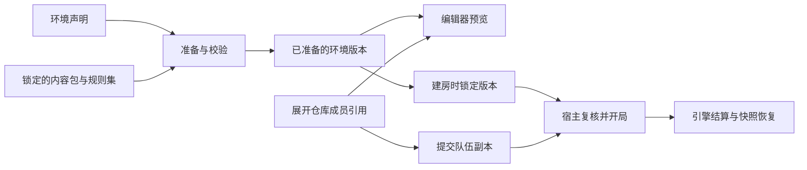

# 对战环境系统：需求与完整设计

2026-11-18 · 总设计提案。本文作为产品需求与设计决策的主入口。规则契约、界面细节、源码落点和验收步骤由文中链接的专题维护。已实现版本化规则、房间锁定和共享队伍成员。专项验收进度见[实施计划](environment-implementation-plan.md)。

## 1. 要解决的问题

环境作者应当能发布一套有明确版本的玩法，选择内容包，调整精灵能学什么、队伍能带什么，以及技能采用什么数值。玩家应当能用已有仓库精灵尝试不同环境，看懂某只为什么可用、换一招影响谁，并带着确认过的队伍进入房间。系统借鉴 Pokémon Showdown 的规则组合能力，竞技分级、使用率统计与升降级不在本轮需求内。

| 交付实例         | 养成与配招                                                                                                                  | 作用                                                                        |
| ---------------- | --------------------------------------------------------------------------------------------------------------------------- | --------------------------------------------------------------------------- |
| 官方基础环境     | 六项个体各 0–31。新增二代性格与遗传技能，仅向支持遗传的物种开放。二代性格两增两减，玩家可从有效遗传池选至多一招。禁止神魔化 | 默认玩法，保持既有数值行为                                                  |
| 官方扩展测试环境 | 复用基础规则，将六项独立上限改为 120，可同时填满。开放已交付的神魔化方案，可选择技能数值试验方案                            | 可选对照环境，验证数值、编辑和战斗链路                                      |
| 玩家或社区环境   | 可独立组合个体范围、性格资格、学习来源、物种技能改动、队伍限制及技能数值                                                    | 一等使用场景。以“上限 50、全体可选二代性格、关闭遗传技能”为首个独立验收样例 |

## 2. 谁拥有什么

**对战环境**是玩家组队、匹配和建房时选择的一套具名玩法。作者在**环境声明**里选择内容和规则；工作区据此生成**已准备的环境版本**。房间创建时取得其中一个版本，后续操作始终使用它。

| 对象             | 负责的内容                                                                                                                                         |
| ---------------- | -------------------------------------------------------------------------------------------------------------------------------------------------- |
| 内容包           | 定义物种、技能、性格、属性、默认相克关系、遗传资格与池、神魔化阶段、效果实现及公开参数。包作者维护这些定义                                         |
| 规则集           | 将一组调整具名供多个环境复用。单个环境可以直接写自己的调整                                                                                         |
| 环境声明         | 作者编辑的文档，记录名称、直接依赖要求、可选规则集、机制选择与本地例外。环境 ID 标识这套玩法，声明修订用于检查并发保存                             |
| 已准备的环境版本 | 工作区根据声明和锁定材料，校验引用、处理规则冲突，生成只读的有效内容目录与规则，记录生效值的来源和所需运行能力。玩法版本标识供预览、房间和宿主核对 |
| 服务器绑定       | 管理本服开放哪些对战环境、能否匹配、默认选择及执行策略。工作区持有权威声明和准备产物                                                               |
| 仓库与队伍       | 仓库中一只精灵保存一套配法。个人队伍按顺序引用具体实例，可记住查看环境的偏好。作者项目的队伍文件自含完整成员                                       |
| 房间与战斗       | 房间建成时锁定已准备的环境版本，玩家提交队伍时再捕获成员副本。宿主按锁定版本校验准入，引擎执行计算、换宠与结算，保存对局动态状态                   |

例如晶属性包定义晶攻火为 2 倍。作者只想在某个对战环境把它改为 1.5 倍，声明里只写这一格。准备过程解析出有效相克表，图鉴读取倍率，引擎用它计算伤害。已经建好的房间继续用建房时的表。

仓库保存安全可读取的草稿。参战资格相对于某个环境版本判断。相同草稿可以在基础环境保存、在社区环境通过、在缺少依赖的环境暂时无法校验。

## 3. 环境作者怎样定义玩法

**内容与规则。** 作者在环境管理页选择包及版本，复用可选规则集，看到每项的生效值及来源。多个规则集组成有向无环图。个体上限等单值规格由明确覆盖替换；队伍数量、物种禁令、技能限额和组合禁令共同生效。规则按稳定 ID 增加、删除或替换，例外绑定具体禁令。循环、悬空例外、未知引用及未解决的冲突在准备时定位到字段。详见[规则组合与优先级](environment-rule-composition.md#默认与冲突)。

**养成。** 个体上限、默认填值和属性公式分别配置。性格从完整定义中选择。二代性格与遗传技能分别拥有“按物种默认／全部／指定集合”的适用范围，选二代性格无需先选一招遗传技能。神魔化可设为禁止、启用或“保留并验证记录，本局不生效”。启用时环境选方案与允许阶段，玩家选分支与阶段，数值来自锁定的内容表。

**性格与属性的归属。** 现有 25 种普通性格、23 种战斗属性（水、火、草等）和 529 个攻防倍率一起迁入官方基础包。基础环境和 120 测试环境都引用这份内容。玩家为精灵选性格，物种与技能自带属性；引擎按本场锁定的定义计算六维与伤害。社区包可以提供新性格、属性和基础相克表。包进入环境后，它为自有属性声明的攻防关系随属性自动生效。可选平衡规则集由作者另选。两个包对同一方向给出不同默认倍率时，编辑器列出双方来源，由环境作者为该格明确取值。环境选定基础表后可以单改一格。例如两个独立包分别新增晶、音属性，两者都未声明交互时，晶攻音、音攻晶各为 1 倍。环境把晶攻音设为 2 倍，只需保存这一格。详见[基础包与相克表设计](environment-rule-composition.md#基础包中的性格与战斗属性)。

**战斗规则。** 环境作者在“战斗规则”里设置“击破奖励换宠”。开启时，战斗尚未结束且引擎判定一方获得击破奖励，该方可换宠或留场。关闭时只取消这次额外选择，倒下方仍须按原规则补位。基础环境沿用现行默认开启，120 测试环境继承基础值，社区环境可单独覆盖。玩家在组队或入房时可从环境摘要查看生效值，仓库精灵和队伍均无需填写。房间按建房时锁定的版本执行。

**配招。** 对开放遗传的物种，作者可沿用原池、用公共池补空、追加公共池或统一使用公共池，再逐物种增减。给迪兰特的普通学习表移除一招后，它仍可经合规的遗传来源取得；若任何来源都禁止装备，用“物种＋技能”单宠禁令。学习结果、装备槽和全队限制分别检查。普通槽与必杀槽来自有效规格，额外学习机会本身不增加装备槽。详见[资格与学习池调整](environment-rule-composition.md#环境内的资格与学习池调整)。

**扩展边界。** 新性格、新阶段、已支持的学习表与规则组合通过数据交付。若将来有技能需要玩家在编队时选火／水形态，增加带参数的装备条目，在对应槽内选择。若允许战斗中从备招换招，还要实现动作、消耗、可见信息和恢复语义。环境准备与宿主接入均检查必需能力，缺失时保留草稿并报告具体能力。

## 4. 技能数值怎样跨环境、跨包生效

内容包维护有命名空间的参数组，技能作者显式把某个效果使用位置的公开参数接入组。社区技能可以依赖官方组。环境作者选整套方案、改一个组或固定某一招。每个地址按“单招例外 → 环境组覆盖 → 所选方案组值 → 内容基础值”取值。环境编辑页显示生效值、成员、例外和变更预览；“跟随组值”删除该条固定例外。个体范围与技能数值方案可独立选择。

冻气喷射按自身最大体力超过基准的部分加威力，其触发判断和减法必须读取同一个参数。假设最大体力 600，基础值 500 时加 100 威力；组值取实验值 576 时加 24。若同组的社区冰爆单独固定为 550，它加 50 伤害。只有显式带相应战斗标签的参数才继续受印记等作用域修正。技能说明显示本环境实际基准。

组归属、跨包绑定、优先级和编辑页属于新增设计。每次 BehaviorUse 的独立身份、参数合同、原生构建和战斗内标签机制可复用。涉及的旧硬编码效果须逐个接入一次。详见[数值组设计](environment-rule-composition.md#技能效果的环境数值方案)与[冻气喷射贯通任务](environment-implementation-plan.md#冻气喷射从-500-到环境参数的贯通任务)。

## 5. 玩家怎样组队和切环境

个人编辑器顶部显示队伍和查看环境，中间编辑选中成员的“配招／养成”，摘要区给出六维结果、计算明细与问题定位。窄屏折叠明细，保留当前成员和问题入口。环境预设选择玩法；单宠预设只填写玩家选择，应用前显示差异，应用后可撤销。

例如甲队当前位置是 120 资质、已强化的迪兰特。切到基础环境时，仍显示这只及两处违规。打开仓库可查看 31 资质的另一只，先预览替换后的整队，再决定换人。昵称相同可按技能、养成差异或实例短码区分。浏览环境保持原数值和成员，单宠可用与整队可参战分别显示。

**每只仓库精灵保存一套完整配法，个人队伍按实例 ID 引用具体的精灵。** 同物种要保留两套配法，就保存为两只。替换甲队成员只改甲队的引用。移出成员或删除队伍后，精灵仍在仓库。甲、乙两队共用一只时，从甲队给它改招可选择“复制一只给甲队”，或查看受影响队名后修改原只。删除被引用的精灵之前先处理引用。保存按档案修订检查，预览缓存同时绑定档案身份、队伍及有序成员修订和环境身份。完整队伍导出或提交房间时展开成员选择。详见[仓库操作与迁移](environment-storage-adaptation.md)和[编辑器交互](environment-team-editor.md)。

## 6. 从环境应用到一场对局

1. 作者准备候选环境，校验依赖、规则、公开参数与宿主能力。工作区单写所有者提交声明、锁及准备产物，服务器管理绑定、权限与使用状态。准备失败保留旧环境；提交成功而绑定加载失败时分别报告，重试成功才向新房间提供新版。基础包随程序同步，第三方依赖按锁定版本使用。沿用[环境依赖与管理模型](content-environment-model.md)。
2. 组队、仓库详情、作者预览和 CLI 显式使用所选对战环境的已准备版本。共享计算按确定顺序处理种族、等级、个体、学习力、性格、强化及取整。宿主复核原始选择与全部装备来源，完成全队约束与属性派生。缺资料只影响依赖该资料的预览，完整通过才能 Ready 或开局。
3. **建房时锁定已准备的环境版本。** 建房取得版本标识及对应材料的使用权。等待、Ready、开局、换房主、重连及同房再战均沿用该版本；恢复时若材料缺失，须重新提供匹配该版本的材料。要改变玩法则新建房间。环境更新影响后续新房和匹配，旧队列重新核对版本。房间校验与战斗创建读取相同规格，变身、重算、忽略印记和恢复快照使用捕获的运行上下文。
4. 个人 P2P 环境只在本场使用。离房恢复个人查看环境，释放临时材料。玩家明确保存的精灵仍可查看、复制与导出。原环境不可用、目标缺少该技能、目标明确禁用该技能分别显示。再取得同一版本材料后重新校验。材料准备与代码执行各按现有宿主政策授权。

## 7. 迁移、交付与验收

先固定旧版 31 属性与档案样本，再把草稿结构、环境准入和运行状态拆开。档案／备份读写升级和引擎计算可并行，之后让网页、桌面、CLI、房间与作者入口接入。先交付基础遗传，再开放独立的 120 与强化测试环境。阶段任务、代码落点和回退步骤见[完整实施计划](environment-implementation-plan.md)。

## 8. 放行前仍需决定的事项

| 项目                  | 当前结论                                                                                                                     | 最迟决定时间                                                       |
| --------------------- | ---------------------------------------------------------------------------------------------------------------------------- | ------------------------------------------------------------------ |
| 原作遗传与二代性格    | 已有十条亲本展示记录、十种二代性格的客户端资料。后代有效池、遗传占槽／卸下规则及“可爱”的体力项仍需补证                       | 官方基础环境开放对应条目前                                         |
| 120、神魔化与技能平衡 | 已有六项分别 /120 的面板、十六个强化阶段及按当前阶段显示的加成。原作应用时点、取整、变身交互和首批阶段范围待核。576 为试验值 | 标为准确复刻或确定正式平衡参数前；试战采用明确命名的版本化实验规格 |

原客户端证据、适用版本及外部配队工具的取舍见[原作与工具调研](environment-reference-research.md)。产品验收以实际运行场景为准。
