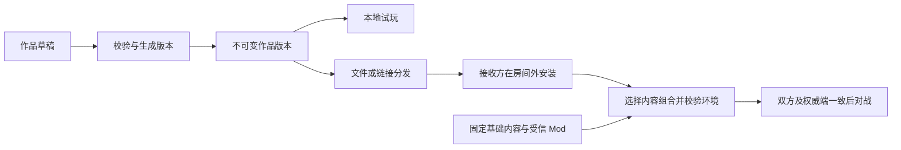

# 统一作品模型、三级 UGC 与创意工坊设计

状态：2026-10-25 确认的设计依据，尚未实现完整产品链路。三级创作全部纳入目标，分阶段交付；官方创意工坊是待实施评估的主要在线分发候选。本次仅更新文档和 Issue，不将设计验收视为功能完成。

总览见 [#200](https://github.com/arcadia-eternity/arcadia-eternity/issues/200)，术语见 [UGC 领域词汇](ugc/CONTEXT.md)。本文确定作品、创作、分享与对战准入的关系；现有运行语义仍以 [V4 指南](direct-v1-port.md)、[效果编写](effect-authoring.md)和[快照边界](v1-snapshots.md)为准。

## 已确认的产品边界

- 同一作品可以同时使用预设配置、规则组合和原生 TS 扩展；三级是创作深度，不是三套互斥格式或执行权限。
- 本地创作、保存、试玩、文件分享不要求账号或官方服务。生成可运行版本不等于上传或公开发布。
- 作品内容、本机工作区和本局对战环境分别保存。文件路径、全局启用状态、编辑布局不能成为可分享内容的身份。
- 作品在房间外获取和安装。**取消房间内作品同步、资源补传、临时安装和 P2P 内容分发；房间只校验本局环境是否一致。**
- 官方权威对战要求双方客户端与服务器使用相同的规则环境；不匹配时拒绝开始并展示差异。
- 官方创意工坊按候选方案设计；文件和自托管分发继续独立可用。工坊建设不自动改变现有官方服务器上线门槛。
- 普通作品只包含可校验数据、素材和能力引用。代码扩展的构建、安装、信任和服务器准入是独立流程。

## 统一作品模型

### 作品、草稿、版本、工作区和环境

用户可以从“新建精灵”或“新建技能”进入，系统建立作品；需要多个关联内容时，再展开项目视图。界面以创作对象组织，不要求作者先创建文件、清单或安装目录。

| 对象                         | 建议包含的内容                                                                       | 生命周期与约束                                         |
| ---------------------------- | ------------------------------------------------------------------------------------ | ------------------------------------------------------ |
| `Project` 作品               | 稳定 `projectId`、名称与说明、作者声明、内容定义、素材、直接依赖、来源与许可         | 作者的编辑单位；一个技能或一组精灵都可以构成作品       |
| `Draft` 草稿                 | 作品身份、基于哪个版本、编辑 revision、当前定义、未完成配置、诊断                    | 可保存不完整内容；编辑器布局另存，保存成功不保证可运行 |
| `Release` 作品版本           | 作品身份、展示版本号、格式版本、不可变定义、固定依赖、能力要求、素材清单、内容摘要   | 通过校验后生成；更新产生新版本，既有版本不被原地替换   |
| `Workspace` 本地工作区       | 已安装版本、当前草稿、收藏、内容组合、存储位置、编辑偏好和本地信任选择               | 属于设备或浏览器资料；不随作品包导出                   |
| `BattleEnvironment` 对战环境 | 选定的作品和依赖版本、基础内容、规则构建身份、可信 Mod、覆盖配置、运行策略、环境摘要 | 运行前构建并冻结；安装更新和继续编辑不能改变已有对战   |

个人培养、技能选择和队伍属于 `OwnedPet`／`PetBuild` 等玩家资料；对战中的 HP、印记和随机数状态属于战斗实例。两者引用作品定义，默认不进入作品发行包。用户可以另行导出队伍配置，但不得因此携带账号凭据。

### 作品中的内容

| 定义                      | 作者可以维护的内容                                                       |
| ------------------------- | ------------------------------------------------------------------------ |
| 精灵 `SpeciesDefinition`  | 名称、属性、基础数值、技能列表、外观和素材引用                           |
| 技能 `SkillDefinition`    | 技能数值、使用条件、表现及行为使用                                       |
| 印记 `MarkDefinition`     | 持续时间、层数与叠加规则、生命周期及行为使用                             |
| 行为 `BehaviorDefinition` | 可复用身份、公开参数、适用上下文、依赖、说明及规则或原生实现             |
| 素材 `AssetDefinition`    | 稳定引用、字节摘要、格式、展示用途、尺寸／体积、可选质量变体、来源与许可 |

作品引用采用稳定作品身份与对象身份，显示名称和文件位置不作为身份。现有官方内容通过映射接入，不为了统一作品模型批量改写官方 ID。

首版以整个作品版本作为发行单位。单独分享一个技能使用“另存为独立作品”：生成新身份，收集所需行为、印记和素材，并重映射内部引用。不能挑出几份文件后仍声称这是完整的原作品版本。

### 行为定义、使用与运行实例

`BehaviorDefinition` 描述可复用能力；技能或印记中的每次引用是一个 `BehaviorUse`，持有稳定 `useId`、行为引用和独立参数。运行时的技能／印记实例再持有本局可变状态。

这两个名称是作品层概念，与现有效果定义、效果配置衔接：行为定义经校验和装配接入现有 `Effect`，行为使用对应某个使用位置的配置，效果来源仍是具体 Skill／Mark 实例。它们不引入第二套效果执行模型。本文“预设”包括现有效果模板和完整预设的创作入口，参数及捕获／跟随语义沿用原合同。

- 同一技能两次使用同一个恢复预设，需要两个使用实例；修改其中一次不改变另一次。
- 装配到现有运行模型时，效果配置身份必须包含稳定使用位置 `useId`，不能只按行为定义 ID 去重；实际来源实例仍按对战隔离。
- 共享参数由作者显式连接，不能由共享闭包或同一预设引用意外形成。
- 触发、条件、概率和动作节点拥有稳定局部 ID；调整顺序保留 ID，复制时重映射复制范围内的节点引用。
- 诊断定位到作品、内容、使用实例、规则节点和字段，供界面直接定位问题。
- 可复用预设和定义不保存某场战斗的层数、计数器、捕获结果或当前目标。

## 三级创作与相互衔接

| 层级           | 作者操作                                                   | 保存形式                  | 向其他层提供什么                   |
| -------------- | ---------------------------------------------------------- | ------------------------- | ---------------------------------- |
| 一级：配置创作 | 创建精灵／技能／印记，选预设，调数值、参数和素材，立即试玩 | 行为引用与本次使用的参数  | 使用二级、三级作者提供的能力       |
| 二级：规则组合 | 配置触发、条件、概率、目标、取值和有序动作，制作自定义印记 | 受控、可校验的规则结构    | 将组合封装为一级可用的预设         |
| 三级：专业扩展 | 用 TS 编写现有规则无法表达的机制，导出原生行为或可组合能力 | 明确构建的 Mod 及能力声明 | 扩充二级能力库，或直接导出一级预设 |

三个入口共享行为参数和引用合同。作品不设置一个决定运行权限的 `level: 1/2/3`；基础作者也可能引用第三方 Mod，进阶作者也可以只使用内置能力。

### 一级：让作者完成一件作品

主流程为“新建／复制 → 编辑精灵或技能 → 选择效果并填参数 → 试玩 → 修复问题 → 保存版本 → 分享”。依赖和素材由系统汇总，文件管理放在高级操作中。

预设展示名称、效果说明、适用对象、参数范围、依赖和可展开性。缺少参数或素材时仍能保存草稿；试玩和可运行导出必须通过完整校验。错误提示回到具体字段，不要求作者查目录或手写 YAML。

### 二级：规则卡片与可复用预设

首版采用“何时触发 → 满足哪些条件 → 是否通过概率 → 按顺序执行动作”的规则卡片。目标、数值来源、进入时捕获和持续跟随使用有明确含义的选项；不会向普通作者暴露任意对象路径、表达式或执行函数。

作者可以把组合封装为行为定义，选择公开参数、说明和范围。基础作者看到参数页，规则仍完整保存。自由节点画布可后续作为同一模型的另一种编辑视图，画布坐标不决定执行顺序。

### 三级：能力合同与可信代码

每项导出至少声明稳定身份、版本、参数 schema／默认值／有效范围、适用上下文、编辑说明、依赖、支持宿主和构建身份。完整原生行为可以直接提供参数页；可组合能力则进入二级的触发、条件、动作或取值库。

原生 TS 可以直接表达正式效果，不要求将全部官方实现翻译成规则。扩展仍遵守战斗核心的事件、顺序和状态合同；需要改变核心语义的新机制应明确依赖对应核心版本。

可跨宿主运行的战斗逻辑使用核心提供的确定性随机数和输入，不能由系统时间、任意网络结果或本机文件决定战斗结果。宿主功能与战斗回调分离。任意不可信 TS 的隔离执行环境不由“支持三级创作”隐含承诺。

### 展开、封装与升级

1. **预设展开**：仅对声明可展开的预设开放。生成独立规则副本，保留公开参数、共享关系、来源和节点映射；产生新的内容版本，不自动追随上游。
2. **规则封装**：作者选择公开参数，其余结构封装；公开参数只能使用受支持类型和插槽。
3. **原生行为**：可以可配置而不可展开。不能通过丢弃逻辑伪造可编辑规则。
4. **回到基础页**：规则超出原预设表达范围时，仍显示摘要和公开参数；不静默删除高级内容，也不声称已还原为原预设。
5. **依赖升级**：先生成候选草稿，展示变更与诊断，校验后产生新版本。旧版本及已有对战保持固定。

贯穿验收场景：一级作者制作“命中后有概率附加持续恢复印记”的技能，填写概率、回合和恢复比例；二级作者展开，加入生命阈值条件，再封装为两个公开参数的新预设；三级作者补充缺失的取值能力，二级使用后，一级仍通过参数页创作。这是目标验收场景，不代表公开能力库已经具备全部能力。

## 内容身份、依赖和迁移

### 复制、派生和覆盖

- 重命名、移动文件不改变内容身份。
- 普通复制生成新对象身份，复制项目生成新 `projectId`；复制范围内的引用一并重映射，外部依赖保留。
- 自动重映射仅覆盖有声明的结构化引用；任意 TS 回调中的硬编码引用不能自动重写。此类作品须保留原扩展依赖，或由专业作者显式调整、重新构建并验证；不能宣称复制过程已重写全部原生逻辑。
- 派生作品记录来源和来源版本；来源声明不证明作者身份或再分发权利。
- 默认修改官方内容采用复制；覆盖是独立进阶操作，显式指定目标、目标版本和适用内容组合。
- 同一组合中的覆盖冲突必须拒绝或由明确配置解决，不能由导入先后、读取速度或隐式“最后一个生效”决定。

### 固定依赖与三个摘要

草稿可以保留兼容版本范围和未解决依赖；可运行版本必须解析为精确版本，验证完整依赖集合。可安装多个版本，首版每个对战环境只选择同一作品的一个版本，不自动取最新。

| 身份用途     | 覆盖内容                                                      | 不代表什么                                 |
| ------------ | ------------------------------------------------------------- | ------------------------------------------ |
| 传输摘要     | 收到的归档或资源字节                                          | 不证明作者身份或代码可信                   |
| 作品内容摘要 | 规范化定义、有效参数、依赖和素材清单；保留动作等有语义的顺序  | 不包含本机目录、编辑布局、收藏和启用状态   |
| 环境摘要     | 精确作品集合、基础内容、规则构建身份、Mod、覆盖配置和运行策略 | 不证明客户端未作弊，也不替代服务器权威校验 |

跨宿主比较的是共同规则构建身份；浏览器、Electron 和 Node 的打包外壳不同，不应因此把同一规则环境判为不同。各宿主实际构建与共同规则身份的对应必须由可信发布流程确定，不能由客户端自行宣称兼容。

纯展示素材可有多个质量版本，资源清单和各变体摘要固定；本地缓存了哪个已声明变体不改变战斗语义。会影响战斗行为的数据必须完整进入环境校验，不能以“素材”名义跳过。

格式升级在副本上迁移，保留原包和原版本；无法理解的新格式给出兼容性说明，不进行部分激活。保存与导入使用候选校验和一次提交，失败保留最后有效状态。并发编辑冲突不能静默覆盖另一份草稿。

作品升级不自动升级旧对战或旧快照。快照继续要求其原环境及现有协议支持的等待点；不得修改 revision 字符串来伪装兼容。

## 分享和安装

### 三种交付物

| 交付物       | 内容                                                                 | 接收位置                   |
| ------------ | -------------------------------------------------------------------- | -------------------------- |
| 创作源项目   | 可编辑定义、素材、来源、当前依赖声明和必要编辑信息，可包含未完成草稿 | 编辑区；通过校验前不能运行 |
| 可运行作品包 | 固定版本、可验证数据、素材、精确依赖及能力要求                       | 本地安装库；可用于环境装配 |
| Mod 扩展包   | 编译代码、导出声明、支持宿主、构建身份；源码可另附                   | 独立的扩展安装与信任流程   |

候选扩展名为 `.arcadia-project`、`.arcadia`、`.arcadia-mod`，最终名称和容器细节在格式实现时确定。实际判断依据是包内 `kind` 与 `formatVersion`。素材按文件保存，避免把大体积二进制全塞进文本字段。

普通作品导入不隐式执行安装脚本、JS 或 TS。引用未安装或未获准 Mod 的作品可以查看和编辑其数据，但必须显示不可运行及缺失原因。

### 分发渠道

| 渠道                 | 场景                               | 基础设施与限制                                         |
| -------------------- | ---------------------------------- | ------------------------------------------------------ |
| 文件导入／导出       | 私下发送、离线拷贝、备份、二次创作 | 不依赖官方账号或服务；首期必需                         |
| 自包含文本码／二维码 | 无大素材的小型配置或作品           | 内容真实编码在码中；超过渠道预算改用文件或链接         |
| 固定版本链接         | 工坊、作者站点、社区镜像           | 链接定位版本，摘要确认内容；镜像可以替换来源           |
| 短码                 | 便于输入和传播的作品定位符         | 必须有解析服务，显示用途和有效期；不是离线内容本身     |
| 官方创意工坊         | 公开发布、发现、下载和更新         | 候选在线分发入口，见下节；不阻塞文件分享               |
| 开发者扩展分发       | 专业 Mod 发布                      | 独立安装、启用、禁用和回退；不进入普通作品自动导入路径 |

房间邀请码只用于加入房间，不承担作品分发。链接和二维码都不是大素材包的替代存储；“最新版”入口只用于发现更新，开战和固定分享链接必须指向明确版本。

### 统一导入流程

1. 读取清单和交付物类型，限制容器大小、解压量、文件数量、路径和资源类型；任何类型都不能绕过这些检查。
2. 展示作品、来源、作者声明、内容大小、平台与能力要求；检查本地固定依赖。
3. 按类型处理：源项目验证可保存的草稿结构，允许占位、未完成字段和未解决引用，记录语义诊断，不要求先补齐依赖；可运行作品包在房间外取得缺失的普通数据依赖；Mod 包转入独立安装流程，普通导入不执行代码。
4. 预览身份冲突，明确选择恢复草稿、新安装、升级或另存副本；不静默覆盖。
5. 源项目在容器、草稿结构、身份和资源检查通过后一次提交到草稿区；可运行作品包必须完整验证依赖、引用、摘要、参数、规则和资源预算，才可提交安装库。两条路径失败均保留原内容。

源项目导出同样允许不完整，保留诊断和依赖声明；不能标为可运行版本。导出 Release 才要求完整运行校验，缺少或未允许的代码依赖不能被当作已满足。

默认导出作品与必要内部依赖，官方基础内容用固定版本引用；需要携带外部素材时保留来源和许可，不能把有下载地址当作可再分发证明。账号、凭据、绝对路径、个人队伍和战斗快照不自动进入作品包。

## 房间只做环境一致性校验

### 校验范围

房主从已安装内容选择一个公开的内容组合。组合描述允许使用的内容，与双方秘密选队分离，不从某一玩家的实际队伍推导并公开依赖清单。

| 参与一致性校验                               | 不要求双方相同                                   |
| -------------------------------------------- | ------------------------------------------------ |
| 基础内容版本、所选作品及依赖的精确版本／摘要 | 整个本地作品库、未使用的其他作品                 |
| 核心／能力库的规则构建身份、允许的 Mod       | 草稿、收藏、本机路径、编辑布局                   |
| 显式覆盖配置、房间运行策略                   | 纯展示素材的缓存状态和已声明质量变体选择         |
| 服务器批准并可加载的固定环境                 | 双方自己的队伍和培养数值；各自仍须通过合法性校验 |

握手只交换版本清单、摘要和差异，不发送作品内容。环境匹配后才能准备、开始；不匹配时显示“缺少作品”“版本不同”“内容被修改”“宿主不支持”或“服务器未允许”，并提供返回作品管理或查看工坊作品的入口。

下载、安装和更新在房间外完成，完成后重新校验。房间不承担下载队列、P2P、资源中继、临时内容缓存或自动更新。已有好友对战的网络传输选项仍由 #211 管理；取消的是 UGC 内容同步，不是取消所有 P2P 对战能力。

一致性校验可以使用玩家从本地、文件或自托管地址取得的作品，不以工坊存在为前置。官方权威服务器仍可按自身准入策略限制可用版本；社区服务器独立决定允许的组合。

### 权威端与生命周期

官方权威对战要求**两端客户端及服务器的环境一致**。服务器只装配已通过准入的版本，独立校验队伍和指令。客户端报告相同摘要仅完成兼容性握手，不能替代权威端验证。

开局后环境冻结，工坊新版本或本地安装变化不影响本局。创建新房间时重新检查服务器准入；已经运行的环境保留必要引用，不能因为作品被卸载或普通更新而失去其规则内容。安全撤回如何影响进行中对局需明确服务器策略，不采用隐式热替换。

| 验收场景                                | 预期结果                             |
| --------------------------------------- | ------------------------------------ |
| 房间需要 A 与 B 1.2，玩家还安装了无关 C | 允许；C 不进入本局环境               |
| 玩家只有 B 1.1 或没有 B                 | 拒绝开始，列出差异；不自动下载       |
| 版本号相同但定义被修改                  | 摘要不符，拒绝开始                   |
| 双方一致但官方服务端缺少或禁止 B        | 拒绝官方对战，说明准入状态           |
| 两人队伍不同，但都符合 A 与 B 的组合    | 通过各自合法性校验后允许             |
| 战斗期间工坊发布 B 1.3                  | 本局继续使用 B 1.2，后续房间另行选择 |

## 官方创意工坊候选方案

工坊负责作品获取与版本管理，房间负责内容准入。它可以归入官方服务体系，上传下载与权威对战的职责分开，避免在玩家进房时临时处理上传包或执行新增代码。

| 部分     | 责任                                                           |
| -------- | -------------------------------------------------------------- |
| 工坊入口 | 作品介绍、预览、分类／基础搜索、依赖、兼容要求、版本及发布状态 |
| 发布模块 | 已认证发布者、上传授权、配额、候选校验、版本登记和下架         |
| 文件存储 | 不可变发行包、素材、预览文件；可配置对象存储与镜像             |
| 对战准入 | 确定服务器允许的能力和版本，构建可用规则环境                   |

第一版建议包含：

- 使用项目统一账号体系登录发布；公开浏览与下载尽量无需登录，本地创作保持无账号。
- 作品详情显示作者声明、经验证发布者、来源与许可、预览、体积、依赖和支持平台。
- 不可变版本列表、固定版本链接、下载、明确的更新操作；首版不自动更新已选内容组合。
- 服务端在发布阶段校验格式、引用、摘要、规则、依赖及资源预算；发布可见与官方对战准入分别记录。
- 基本上传配额、举报、下架和发布者管理。评论、关注、推荐算法、自动订阅更新及实时协作后置。

作品页分别显示“当前客户端能否运行”和“是否允许官方 UGC 对战”。本地可玩不代表官方服务器支持；下架可影响继续分发及官方准入，不能承诺删除别人已下载的离线副本。

首期普通发布流程面向数据作品与素材。三级作者使用内置能力制作的预设同样可以发布；新增 TS 能力必须通过独立扩展流程确定构建、宿主支持、安装信任与服务器准入。工坊不会因收到作品上传就自动执行其代码。

工坊不要求新建中央身份系统。发布者验证沿用服务器范围账号；作品作者自述、内容一致性摘要、发布者身份和代码准入分别表示不同事实。

#225 保持 **P3／可选后置**；本设计未决定工坊部署、启用或提前上线。既有官方维护服务器公开上线至少 G4 的要求继续由 #219、#233、#234 跟踪，工坊候选不会绕过该门槛；文件分享和环境一致性校验也不因此等待工坊。

## 平台约束和外部需求

### 各宿主的共同合同与适配

| 平台                 | 目标能力                                 | 设计要求                                                                           |
| -------------------- | ---------------------------------------- | ---------------------------------------------------------------------------------- |
| 普通 Web／PWA        | 一级、二级编辑，本地试玩，文件和链接分享 | IndexedDB 等本地存储适配；始终提供导出备份；能力检测和明确失败提示                 |
| 移动浏览器／内嵌页面 | 相同作品模型，触控和小屏流程             | 分别检测文件接收、下载、分享、存储及后台限制；提供外部浏览器入口                   |
| ChatGPT Sites        | 候选 Web 客户端与作品展示入口            | 实测资源、存储、导入导出、跨域、登录和房间连接；不假定现有 Node 权威服务可直接迁入 |
| Electron             | 完整编辑、离线作品库、明确安装的可信扩展 | 用户内容放用户目录，官方资源只读；隔离渲染与系统接口，校验 IPC 来源                |
| CLI／服务器          | 校验、构建、导入导出、测试与权威运行     | 共用作品和规则合同；可省略纯展示资源，不能省略影响战斗的依赖                       |

浏览器存储按来源隔离且可能被清理，持久存储申请不能替代备份；跨域名、跨设备迁移需要显式导入或将来的同步功能。[MDN 存储配额与清理](https://developer.mozilla.org/en-US/docs/Web/API/Storage_API/Storage_quotas_and_eviction_criteria)

系统分享作为增强入口，需要安全上下文、用户操作及相应权限；检测可分享能力后再调用，保留下载文件和复制链接。文件选择器扩展接口也不能成为唯一入口。[Web Share](https://www.w3.org/TR/web-share/)、[文件选择器兼容性](https://developer.mozilla.org/en-US/docs/Web/API/Window/showOpenFilePicker)

自托管地址能在浏览器打开，不代表网页脚本可读取；链接导入需要 CORS 等配置，无法读取时可下载文件再导入。未来若增加服务器代取，须另行约束目标、跳转和凭据，不能默认引入开放代理。[MDN CORS](https://developer.mozilla.org/en-US/docs/Web/HTTP/Guides/CORS)

Web 专业扩展首期由宿主预装或构建进去；Electron 也不通过作品导入授予 Node 或系统权限。Worker、独立进程等执行位置本身不构成任意恶意代码的完整安全保证。[Electron 安全建议](https://www.electronjs.org/docs/latest/tutorial/security/)

Sites 官方支持 HTTP、HTTPS 和 WebSocket，同时限制部分后台服务和托管方式。支持连接协议不代表本项目已通过部署验收，实际支持仍由 #219 记录。[Sites 官方文档](https://learn.chatgpt.com/docs/sites)

包格式不绑定托管商限制。例如 Cloudflare Pages 单个静态资源上限为 25 MiB，较大作品包可以使用对象存储；该限额不应套用到所有平台或定义为作品格式上限。[Pages 限制](https://developers.cloudflare.com/pages/platform/limits/)

### 外部需求的预留

| 需求                 | 当前进入模型／流程                                     | 后续能力                       |
| -------------------- | ------------------------------------------------------ | ------------------------------ |
| 移动端与弱网         | 体积提示、可选素材质量、缓存、取消下载、触控与可读诊断 | 断点续传、镜像选择             |
| 复制、派生与多人协作 | 稳定 ID、来源版本、独立草稿、编辑冲突处理              | Git 工具支持、云备份、实时协作 |
| 社区及第三方工具     | 可公开的格式、固定身份、可替换下载来源、CLI 校验       | 多社区目录与聚合搜索           |
| 素材生态             | 来源、许可、署名、显示用途、尺寸和格式预算             | 更多动画格式和转换工具         |
| 账号与发布运营       | 作者自述和发布者身份分离、版本撤回与准入状态           | 更完整审核、申诉和存储治理     |
| 公平对战与赛事       | 明确允许的作品、Mod 和资源策略                         | 社区赛事审核、官方排位白名单   |

首期素材优先采用受支持的图片、音频等形式；带脚本能力的资产需要独立处理流程，不能借素材上传自动开放 HTML／JS。现有官方 SWF 沿受信官方资源路径使用，不据此承诺接受任意用户脚本素材。

包体积、解压量、文件数、纹理尺寸、依赖深度、规则动作与运行预算由共同策略定义，可区分本地、好友和公共服务配置。具体数值需用真实作品及低性能设备验证后确定；三端不能各自默许不同的战斗语义限制。

## 分阶段交付与任务归属

设计同时预留三级合同，实施按完整创作闭环逐步推进。阶段顺序描述依赖关系，不自动修改既有优先级或里程碑。

| 阶段     | 交付范围                                                 | 验收目标                                       |
| -------- | -------------------------------------------------------- | ---------------------------------------------- |
| 共同基础 | 作品／行为／版本／环境合同，存储和导入的共同规则         | 三宿主保存、校验同一作品，工作区状态不污染导出 |
| 一级闭环 | 精灵／技能表单、最小公开预设、素材、试玩、草稿和文件分享 | 无账号、无代码完成创作与对方安装使用           |
| 二级闭环 | 规则卡片、印记、展开与封装、环境一致性准入               | 二级成果可供一级使用；缺失或不同版本不能开战   |
| 三级完善 | 复用已有 TS 作者底座，补导出合同、构建、安装、兼容与回退 | 新能力可供前两层复用，代码信任和运行条件明确   |
| 分发增强 | 自托管链接、短码、候选官方工坊                           | 版本可固定获取；工坊不可用时文件分享仍可用     |

| Issue                                                                                                                                            | 本设计中的责任                                                        |
| ------------------------------------------------------------------------------------------------------------------------------------------------ | --------------------------------------------------------------------- |
| [#214](https://github.com/arcadia-eternity/arcadia-eternity/issues/214)                                                                          | 作品、草稿、版本与工作区的跨宿主存储；只读 Base、冲突、原子提交与迁移 |
| [#215](https://github.com/arcadia-eternity/arcadia-eternity/issues/215)                                                                          | 精灵创作入口与定义／个人宠物／战斗实例分离                            |
| [#216](https://github.com/arcadia-eternity/arcadia-eternity/issues/216)                                                                          | 技能、印记和行为使用的作者流程、试玩与诊断                            |
| [#223](https://github.com/arcadia-eternity/arcadia-eternity/issues/223)                                                                          | 行为合同、公开预设、规则组合、展开封装及三级衔接                      |
| [#217](https://github.com/arcadia-eternity/arcadia-eternity/issues/217)                                                                          | 交付物格式、依赖完整性、房间外导入导出、文件和链接分享                |
| [#218](https://github.com/arcadia-eternity/arcadia-eternity/issues/218)                                                                          | 数据／代码信任分离、预算、Mod 安装及权威端准入                        |
| [#224](https://github.com/arcadia-eternity/arcadia-eternity/issues/224)                                                                          | 内容组合、不可变环境、客户端及权威端一致性校验；取消房间内容同步      |
| [#225](https://github.com/arcadia-eternity/arcadia-eternity/issues/225)                                                                          | 官方创意工坊候选、固定版本分发、发布与运营要求                        |
| [#209](https://github.com/arcadia-eternity/arcadia-eternity/issues/209)／[#211](https://github.com/arcadia-eternity/arcadia-eternity/issues/211) | Electron 产品验收／好友房间流程；接入共同作品与环境合同               |
| [#219](https://github.com/arcadia-eternity/arcadia-eternity/issues/219)                                                                          | 宿主能力和实际部署验收，包括工坊存储与权威服务职责分离                |

### 当前事实与待定项

现有代码已有原生 TS 作者能力、有限规则编译、参数／引用校验和内容组合入口；这不等于完整公开预设库、三级作者界面或工坊已实现。此前 #214 的未提交尝试暂停，需按本文模型复核，不能作为新模型已验收的证据。

#223 继续为 **P2／Deferred，归入 M4**；本设计不恢复其作为 M1 前置。一级最小预设子集与 #214 合同需要协调，但完整 #223 产品验收仍按其排期推进。

#214 先确定作品、草稿、版本和本地状态的最小共同合同，再落实跨宿主存储；不以实现完整二级／三级编辑器或全部预设库为前置。后续创作层在该合同上扩展，不把 M4 全部工作提前塞入内容存储验收。

已取消的完整结构化执行记录、完整阶段生命周期 feed、旧快照兼容和扩展阶段过程快照不由本设计恢复。#204 已按收窄范围完成，包括强制／奖励换宠等待点和队伍预选恢复；作品模型沿用这些边界。

候选与实施待定项包括：工坊是否及何时部署、具体托管服务、归档后缀与容器细节、能力库首批清单、各策略预算、Mod 准入流程和发布运营规则。这些需要各自 Issue 验收，不能用本文替代实际平台、权限或运行验证。

### 共同验收清单

- [ ] 同一作品在 Web、Electron、CLI 保存和导入后具有一致内容身份；本机路径和编辑布局不会改变身份。
- [ ] 不完整草稿可以恢复编辑，但不能导出为可运行版本或进入对战。
- [ ] 同一预设的两次使用参数独立；显式共享参数在展开、复制和封装后保持正确关系。
- [ ] 复制、派生、覆盖和升级分别保持约定；旧版本及已有环境不会被静默修改。
- [ ] 文件、固定链接和工坊入口共用校验规则；失败导入保留原安装库。
- [ ] 缺少或未允许的 Mod 明确阻止运行，普通导入不会触发代码安装执行。
- [ ] 房间只交换环境描述和差异；缺少作品、版本不符、服务器未准入均不能开始，也不会自动传包。
- [ ] 选定组合之外的作品不影响加入，不通过公开依赖清单泄露秘密选队。
- [ ] 平台存储、分享和下载能力不足时提供可理解的替代流程；实际部署有独立验收记录。
- [ ] 工坊公开可见、客户端可运行和官方对战准入分别展示；更新及下架不会隐式改写固定版本。
