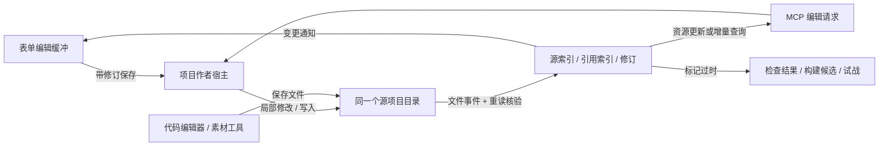
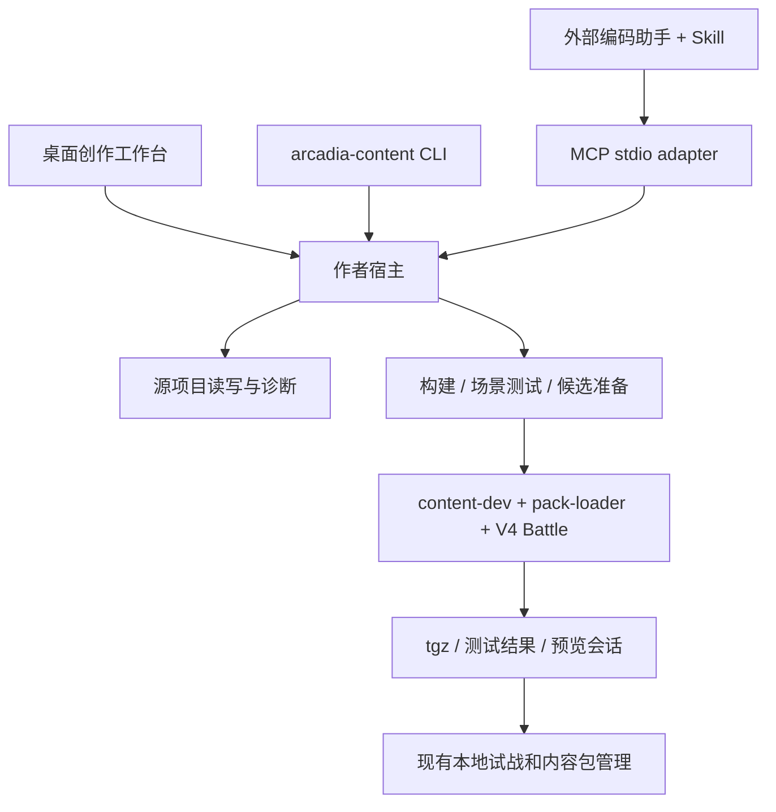

# V4 UGC 工作台、SDK、Agent Skill 与 MCP 设计

状态：早期总体方案，部分已在当前分支实现。调研日期：2026-10-29；最初源码基线：`refactor/v4` / `7105ca1c`。2026-10-30 的对象编辑、保存核对和 YAML 共享字段范围见下文，最新一轮实现尚未回归验证。

Issue 对齐：本提案归 #223，工作区归 #214/#209，精灵与技能／印记归 #215/#216，效果 SDK 归 #242，候选预览归 #244，总览归 #200。2026-10-29 更新这些 issue 的待实施范围，保留此前已验证记录。远程资源与 SWF 隔离遵循 [#254](https://github.com/arcadia-eternity/arcadia-eternity/issues/254) 的最新合同：本地创作不向远程服务器开放作者权限，素材预览复用 #252/#253 隔离播放器；不恢复旧的“服务器认可即可免隔离”假设。

## 2026-10-30：当前实现范围

采用已确认的对象工作台交互：以精灵、技能、印记和资源为入口；文件路径收在来源详情。已有对象的字段、关联选择、名称与描述可编辑，描述支持现有 FormatJS 数值和印记引用预览。代码继续在外部编辑；创建／删除对象、创建语言文件以及资源导入／替换／搬移不在这一版 UI 中开放。模板创建的是完整的新源项目，不是对象管理中的文件创建入口。

草稿按对象和语言保留，切换对象不丢失。保存前查看旧值、新值和已知使用者。同一源文件的修改合并写入；多个文件逐个保存，失败时明确保留未提交草稿。外部变化先保留草稿并暂停保存，逐项核对原值／草稿／外部值；核对结果仅更新草稿，仍需再次保存。来源缺失或重复时禁止写回；来源位置唯一且已改变时，可在明确核对后采用新位置，不自动重建旧文件。

YAML 锚点、别名及合并继承值可读取，共享字段在表单中只读，可定位定义。独立字段和显式本地覆盖值可保存；回写检查共享结构与数据结果。CLI `workspace save`、MCP `content_apply` 和桌面端复用同一结构化保存逻辑。原始源码编辑仍支持有版本检查的 `source_apply`。

以上取代下文早期方案中“只有当前对象缓冲”“多语言仅预览”“所有比较都在外部”以及游戏内对象／素材文件整理的相应建议。总体方案中的其他未来能力不因本次实现而视为完成。

## 1. 建议

围绕一个标准 npm 内容包建立创作工作台。数据表单、外部代码编辑器和 AI 助手共同编辑包的源文件；构建、诊断、场景测试和试战使用同一套作者工具。玩家继续在“内容包”页安装和选择内容，服务器继续决定运行哪些包。

四项交付各有明确职责：

| 交付                       | 用户得到什么                                         | 负责的合同                   |
| -------------------------- | ---------------------------------------------------- | ---------------------------- |
| UGC UI（暂称“创作工作台”） | 浏览内容、编辑数据与展示、查看错误、测试和试战       | 源文件编辑与运行结果的可视化 |
| SDK                        | 用 TypeScript 编写与官方一致的效果，使用真实引擎测试 | 效果语义、数据类型、测试接口 |
| Agent Skill                | 让编码助手按正确步骤完成内容创作                     | 任务流程、领域知识、验证要求 |
| MCP 服务器                 | 让助手查询当前项目、修改数据、运行测试并读取结果     | 工作区的受控操作与结构化反馈 |

首轮选择“对象工作台”作为默认界面，以“场景测试台”作为同一项目的第二个视图。游戏内提供内容管理、结构化表单、资源预览和测试结果；代码、原始数据文件、多语言文本及差异比较交给外部编辑器。游戏内只提供“在外部编辑器打开”与文件定位，不嵌入文本编辑器、代码编辑器或 Diff Editor。

2026-10-29 评审收敛：默认源项目存放在 Electron `userData` 的专用子目录；借鉴 VS Code 的外部文件变更处理，复用 YAML 与成熟文件监听／写入库。用户选择将文本和代码编辑留在游戏外，因此 UGC 不接入 Monaco。首版不做字段自动合并、三方合并器、跨文件事务日志或多人编辑协议。

## 2. 当前能复用什么

以下为本次阅读源码确认的现状，不能把本提案的新接口计入现有能力。

| 现有入口                                                                                                  | 已有能力                                                                 | 本次设计需要补齐                                               |
| --------------------------------------------------------------------------------------------------------- | ------------------------------------------------------------------------ | -------------------------------------------------------------- |
| [`content-dev`](../../packages/content-dev/README.md)                                                     | `check/build/rename/demo/pack/setup`；读取分文件 JSON/YAML、组装展示索引 | 可调用的作者操作模块、结构化诊断、任务状态、源位置映射         |
| [`content-dev/testing`](../../packages/content-dev/src/testing.mjs)                                       | 安装真实 tgz、创建真实战斗、推进回合及收集结果                           | 稳定场景发现、测试结果协议、UI 中的结果定位                    |
| [`battle/v4/authoring`](../../packages/battle/v4-authoring.ts)                                            | 注入式 SDK、原生效果上下文、参数、绑定、领域操作                         | 分层文档、能力目录、可执行配方；保持当前接口                   |
| [作者 Skill](ugc-authoring-agent/SKILL.md)                                                                | 建包、效果语义、测试、准入与预览流程                                     | 修正分文件项目入口，补充按需参考资料和 MCP/CLI 分支            |
| [`DevelopmentWorkspacePage`](../../packages/web-ui/src/features/development/DevelopmentWorkspacePage.vue) | 连接本机开发服务，编辑内容记录及引用                                     | 从聚合内容编辑扩展到分文件源工作区，整合效果、素材、语言和测试 |
| [`DevelopmentWorkspaceClient`](../../packages/web-ui/src/services/developmentWorkspace.ts)                | 回环地址、内存令牌、修订检查、冲突保留                                   | 与玩家当前连接解耦；项目选择和新作者接口                       |
| [`content dev prepare`](../../packages/cli/src/commands/dev-preview.ts)                                   | 打包、独立安装候选，记录源修订和包摘要                                   | 接入受信任预览运行与结果回传；候选准备本身不等于已启动         |
| [`ContentManagerPage`](../../packages/web-ui/src/features/content/ContentManagerPage.vue)                 | 本机包选择、目标与可用状态、房间内容只读                                 | 接受工作台导出的 tgz，保留现有安装体验                         |

`CreatorPage.vue` 与 `ugc-works.md` 中仍有旧作品库／`.arcadia` 流程。新设计以 [npm 内容包合同](npm-content.md)、[内容管理](content-management.md) 和 [展示合同](content-presentation.md) 为准。旧草稿需显式迁移为包源项目；不在本轮静默删除、自动改写或直接挂到新工作台后端。

目前 `content-dev` 的公开导出只有 `./testing`；下文的 `./workspace`、MCP 工具名和任务协议都是提议新增。

## 3. 参考项目与取舍

| 参考                                                                                                        | 可核实的范式                                                                  | 对 Arcadia 的设计推导                                                       |
| ----------------------------------------------------------------------------------------------------------- | ----------------------------------------------------------------------------- | --------------------------------------------------------------------------- |
| [Rojo](https://rojo.space/docs/v7/)                                                                         | 文件工具链、外部编辑器与 Roblox 开发配合                                      | 以包源文件为共同事实来源；UI、Git 与 AI 能协作，不维护第二套浏览器数据库    |
| [Godot Inspector](https://docs.godotengine.org/en/stable/tutorials/plugins/editor/inspector_plugins.html)   | 按对象属性提供编辑控件，并响应外部属性修改                                    | 精灵／技能／印记采用专用属性面板；提供引用选择器和外部变更提示              |
| [Pokémon Showdown simulator](https://github.com/smogon/pokemon-showdown/blob/master/sim/SIMULATOR.md)       | 选择输入与战斗消息输出分离，可通过程序或标准输入输出使用模拟器，并可给定 seed | 场景测试、AI 操作和 GUI 试战复用同一引擎；先支持无界面复现再渲染结果        |
| [Thunderstore profiles / modpacks](https://wiki.thunderstore.io/sharing-your-mods/modpacks-and-profiles)    | 内容包、依赖及用户选择的组合具有不同职责                                      | 保持“作者源项目 → npm 包 → 玩家选择 → 房间固定环境”；组合不是新的内容包身份 |
| [Unity MCP](https://github.com/CoplayDev/unity-mcp/blob/beta/unity-mcp-skill/references/tools-reference.md) | 查询项目能力，异步启动测试并按 job ID 读取结果                                | AI 先读取本项目能力；测试返回任务句柄，诊断可以继续查询                     |
| [Agent Skills](https://agentskills.io/specification)                                                        | 短入口加按需加载的参考资料                                                    | Skill 保留工作流程，把效果配方、恢复合同和测试矩阵放到参考文件              |

这些是职责与交互的借鉴。Arcadia 继续用 npm 依赖、可信 TS、现有 V4 战斗语义和房间固定环境；不引入 Roblox 数据模型、Godot 场景树或 Thunderstore 的分发格式。引用页面中可变分支的状态以本次调研为准，落地依赖另行锁版本。

### 补充调研：外部工具、素材与代码如何配合

| 官方参考                                                                                               | 项目的实际做法                                                                      | 本轮采用的设计及验收                                                                                                                                                                    |
| ------------------------------------------------------------------------------------------------------ | ----------------------------------------------------------------------------------- | --------------------------------------------------------------------------------------------------------------------------------------------------------------------------------------- |
| [Godot 外部编辑器](https://docs.godotengine.org/en/stable/tutorials/editor/external_editor.html)       | 可配置程序及参数，传递项目、文件、行、列；支持外部脚本修改后重载                    | 错误、效果和测试提供文件定位；未配置编辑器时显示文件夹。包含空格／中文路径和定位失败的真实验收。首版沿用 TS 编辑器能力，不另建 LSP/DAP                                                  |
| [Godot 素材导入](https://docs.godotengine.org/en/stable/tutorials/assets_pipeline/import_process.html) | 原素材在项目目录；监听素材变化后重新导入；源文件、导入配置与生成文件各有职责        | 原画／音频工具直接修改源素材，工作台更新索引与当前预览；使用配置留在已有 presentation 合同。保留导出选择，避免把大型创作工程文件全部打入 npm。Arcadia 不照搬其 .godot/imported 缓存体系 |
| [Tiled 脚本 API](https://doc.mapeditor.org/en/stable/manual/scripting/)                                | npm 类型定义提供补全，API 文档由定义生成；同一脚本 API 可在无界面的命令行中处理资源 | SDK 文档、示例和实际类型一致；UI／CLI／MCP 调同一作者模块。用同一个故意错误验证三入口诊断一致；不复制 Tiled 的全局脚本重载行为                                                          |
| [Rojo 同步边界](https://rojo.space/docs/v7/sync-details/)                                              | 文件映射为编辑器对象；受宿主 API 限制的内容需构建文件，不能全部实时同步             | 把源文件刷新、媒体预览与可运行候选分开。文件更新只令旧结果过时，新候选通过后供下一次试战使用；不承诺任意代码或二进制都能热替换                                                          |

这些研究支持“普通源目录 + 专用属性面板 + 外部创作工具”的组合。采用的是各项目明确的工作流；它们并不证明 Arcadia 的保存竞态、跨平台监听或媒体隔离已经完成。

## 4. 产品对象与状态

### 用户看到的对象

- **内容包项目**：作者正在编辑的目录，包含 `package.json`、`data/`、`src/`、`assets/`、`locales/` 和测试。
- **内容对象**：精灵、技能、印记；列表默认显示中文名称，次级显示稳定 ID、来源包和错误状态。
- **资源文件**：图片、音频、SWF、语言文件及作者保留的原始素材；有文件列表、用途、引用者、大小／类型、加载状态和源位置。资源管理是首版工作区的一部分。
- **效果实现**：TS 中的代码导出，供技能／印记引用。用 `useId` 标识使用位置；不会被表单自动翻译为另一种规则语言。
- **测试场景**：队伍、随机种子、选择序列、断言和可选等待点恢复检查。原始场景由普通 TS 测试表达。
- **构建候选**：某次源修订生成的 tgz 及其独立安装结果，供测试、预览或安装。
- **已安装内容包**：由现有 `/content` 管理；正在编写的源项目不直接占用已安装版本的位置。

### 状态独立记录

编辑状态为“已保存／未保存／外部变更冲突”；诊断状态为“未检查／检查中／通过／失败”；候选状态为“未生成／准备中／可用／失败／已落后于源码”。测试成功不会自动保存，保存不会自动构建，构建成功不会自动启用内容。

单文件读取版本用于保存检查；`sourceRevision` 用于构建输入和结果归属，`artifactDigest` 用于此次 tgz，`environmentRevision` 用于运行环境身份。它们不能互相替代。现有环境摘要不覆盖所有本地代码修改；测试与预览记录实际候选及 SDK／引擎构建身份，避免显示无法证明的“完全相同代码”。

界面默认显示“源文件已更新，试战仍使用上次构建”；摘要放在详情中。当前对局继续使用创建时的候选，下一局才使用新候选。

### 工作区放在哪里

默认使用 `path.join(app.getPath('userData'), 'ugc', 'projects', <项目目录>)`。新建项目直接落在应用管理的目录，用户无需先选路径；提供“在文件管理器中显示”“用外部编辑器打开”“导出项目”和可选的自定义位置。已有 Git 仓库支持原地打开，不复制。这里仍是普通 npm 项目目录，内容作者无需把项目放进 Arcadia 主仓库。

Electron 的 `userData` 默认位于平台应用数据目录下的应用名子目录，应用应调用 `app.getPath('userData')` 获取实际值。按本仓库 `productName: Arcadia Eternity`，macOS 正式包通常对应 `~/Library/Application Support/Arcadia Eternity/`；开发／预览构建的名称或路径可能不同，不硬编码。Electron 建议业务文件使用 `userData` 子目录，避免与 Chromium 文件混放。[Electron app 文档](https://www.electronjs.org/docs/latest/api/app#appgetpathname)

资源量很大时允许把项目迁到自选磁盘；Electron 文档也提醒某些环境会云备份该目录，不宜无上限存放大文件。默认目录中的项目属于用户作品，清理临时数据不能删除它们；应用升级保留，提供显式导出备份，不把它们归类为缓存。

首版一个打开的工作区对应一个 npm 内容包根目录。可以登记多个项目并切换，跨包引用仍走声明的 npm 依赖。未来增加多包工作区时，每个包继续保留自己的根、身份和依赖合同。

| 数据                                         | 位置与生命周期                                                                                    |
| -------------------------------------------- | ------------------------------------------------------------------------------------------------- |
| 作者源码和原始素材                           | 默认 `userData/ugc/projects/<项目目录>`，或用户打开的外部目录；升级和临时清理保留，可导出完整项目 |
| `dist/` 与 `node_modules/`                   | 包项目内的生成输出／依赖；不作为可编辑源，不反向同步回 `data/`                                    |
| `.arcadia/`                                  | 保留现有 SDK 安装记录；拟新增状态须分子目录并明确忽略规则，不把用户内容搬入此处                   |
| 最近项目、窗口布局、可选恢复草稿、可重建索引 | 应用 `userData/ugc/state/` 的本机状态；不维护第二份长期源项目                                     |
| 临时测试／预览安装                           | 宿主管理的候选目录，位于源项目外；按任务和运行实例生命周期清理                                    |
| 玩家安装的内容包                             | 现有内容包库；只有明确安装导出的包才进入这里                                                      |

项目登记保存本机工作区句柄与规范根路径；句柄由宿主解析，前端不提交任意路径。首版再次打开同一项目时聚焦已有窗口，减少重复编辑状态。同一 `projectId` 的两个 Git checkout 仍是不同工作区。目录移动后允许重新定位，移出最近项目仅移除登记。CLI/MCP 使用明确传入的项目路径，不自行猜测 Electron 的应用名和目录。

当前 Electron 已使用 `userData/packs`、`creator-works` 和 `content-packages`（见 `electron/main.mjs`）。新源项目使用专用 `ugc/projects`，避免混淆旧数据包和玩家安装库。旧数据走显式“导出／迁移为源项目”，保留原数据到作者确认迁移结果。

项目目录建议如下，素材子目录只是方便整理，不影响引用合同：

```text
frost-pack/
  package.json
  arcadia.config.mjs
  data/
    species/frostling.yaml
    skills/frost-strike.yaml
    marks/slow.yaml
  src/effects.ts
  assets/
    pets/                  # 肖像、战斗图片或 SWF
    marks/                 # 状态、特性与纹章图标
    audio/                 # 叫声、技能音效、音乐
  locales/zh-CN/
  test/
  dist/                    # 生成产物
```

大型原画、工程文件可以放在包内另一个作者目录，通过 npm `files` 排除交付；工作台仍可浏览并在外部软件中打开。包内运行资源遵循 `presentation` 声明，构建索引，不靠某个素材文件夹的名字猜用途。

## 5. UI 方案

### 信息架构

主导航保留“对战、队伍、图鉴、内容包”，桌面增加“创作”。网页端维持房间内容只读与本地工具说明。高级服务器管理继续在设置中；不要求作者先理解、命名运行环境或启动联机服务。

创作首页列出最近打开的项目，提供“从模板创建”“打开项目”。创建只需显示名称，默认位置自动确定，自定义位置可选；自动生成可修改的 npm 名称、`projectId`、namespace，这三项放在高级信息中。模板版本和 SDK 安装来源可查，初次安装仍使用已存在的固定提交／本地 SDK 流程。

桌面选目录由宿主完成；无桌面助手可在启动 MCP 时显式绑定项目根目录。编辑项目与玩家所连接服务器分开，切换对战服务器不改变作者工作区。

### 对象工作台：默认视图

布局为“内容树 / 编辑区 / 检查与预览”，底部按需展开问题和任务结果。

- **内容树**：精灵、技能、印记、效果、素材、文本、测试；支持按名称或 ID 搜索，依赖内容在单独只读分组。特性与纹章在产品中可单独筛选，底层仍按印记处理。
- **精灵编辑**：基本信息、种族值、可学技能、特性／纹章、外观；引用选择器同时展示包来源和可用性。
- **技能编辑**：基本属性、效果引用、展示文本、声音。效果项显示导出、使用身份和来源位置；可以跳转到代码或对应测试。
- **印记编辑**：持续与叠加规则、图标、效果引用。涉及规则含义的说明引用实际 V4 合同。
- **效果引用**：查看已知触发、来源类别、使用位置和文件位置；提供“在外部编辑器打开”。游戏不展示可编辑源码，普通 TS 函数和闭包不尝试自动反向生成表单。
- **素材编辑**：选择包内文件、HTTP(S) 地址或依赖包资源，明确用途与 `image / seer2-swf`；可查看图片、点按试听并检查实际加载失败。按需请求且不缓存，不预下载全部素材。
- **文本预览**：中文优先、语言切换、FormatJS 格式错误和缺失变量提示；通过“编辑语言文件”打开外部编辑器。游戏内可以保留名称等简单字段输入，但不做多语言文件编辑器或富文本模板编辑器。预览需显式选择静态样例上下文或实际测试实例；未知值显示缺失，不推算任意 TS 伤害。
- **检查与预览**：内容卡片、引用关系、使用位置、字段错误。未执行代码时显示“待运行验证”；静态解析不能确认的效果信息明确标注。

按钮的任务含义固定：**保存**写源文件；**检查**检查静态内容／类型；**运行测试**运行选定场景；**试战**准备候选并打开现有完整战斗界面；**导出包**生成并检查 tgz。安装进入现有 `/content` 流程，导出不触发 npm 发布。

### 场景测试台：同一项目的第二个视图

左侧选择测试，中间显示步骤与结果，右侧显示当步的公开状态。底部关联断言、事件日志、恢复检查和外部源码定位入口；测试代码在外部编辑器维护。

例如“命中后减速，重复命中刷新两回合”：看到命中 → 印记存在 → 速度贡献变化 → 再次施加 → 持续时间刷新 → 到期清除。具体数值来自运行记录，不能用静态演示数据冒充引擎结果。

首版直接发现标准测试适配器报告的场景，不解析任意测试代码并承诺可视化编辑。复杂场景在 TS 中维护。结果支持定位失败断言、重跑该场景、打开其战报。事件可观察信息不足时先显示现有日志，参数来源图、绑定依赖解释和任意回合倒退调试留待引擎提供可靠记录后再做。

### AI 协作

首版提供“连接编码助手”和上下文入口，不内建聊天模型、账号或独立计费系统。用户在自己的编码助手中描述机制，工作台显示同一源文件的变化、诊断和测试结果。

可复制的上下文包含项目句柄、内容 ID、相关文件、当前修订、失败场景及引用文档。AI 编辑采用相同文件保存检查；已授权的项目编辑不反复弹确认。连接桌面宿主的 MCP 发现目标文件有未保存编辑时返回 `UNSAVED_CHANGES`，由作者先保存或撤销。外部编码助手直接写磁盘时，按普通外部文件变更处理。

### 保存和冲突

1. 表单保留本地缓冲；保存将一次用户操作映射到明确的记录／字段变更。
2. 保存只核对当前文件自读取后是否变化；变化时保留表单输入并暂停保存，提供“重新加载”或“在外部编辑器处理”。重新加载明确丢弃当前未保存表单；关闭提示可以继续保留输入。首版不提供强制覆盖或内置差异比较。
3. YAML 使用语法树局部修改，保留注释、未知字段和数组布局。复杂别名无法无损修改时提示使用外部编辑器，不写坏文件。
4. 删除对象先列出已知引用，作者决定修复或保留报错草稿；代码中的动态引用只报告不可静态穷举。
5. 显示名、文件路径和稳定 ID 分开。重命名 ID／namespace 作为独立迁移操作，展示影响；不以全文替换修改 TS 字符串。
6. 源码写入可以保留未完成的 TS／不通过业务校验的数据；结构错误不能被表单误读后再整文件覆盖。构建和试战要求通过相应校验。

### 文件修改如何同步

这里的同步指同一台机器上，工作台、AI、代码编辑器和素材工具对同一个源目录的协作。跨机器同步由作者的 Git 等版本管理承担；首版不做云盘或多人协作协议。

**借鉴 VS Code 的外部修改处理规则。** VS Code 遇到磁盘变化会重新加载未修改的模型，跳过有未保存编辑的模型；保存发现磁盘版本已变化时提供比较和覆盖入口。依据是它的 [TextFileEditorModelManager](https://github.com/microsoft/vscode/blob/main/src/vs/workbench/services/textfile/common/textFileEditorModelManager.ts) 和 [TextFileSaveErrorHandler](https://github.com/microsoft/vscode/blob/main/src/vs/workbench/contrib/files/browser/editors/textFileSaveErrorHandler.ts)。Arcadia 只采用“未修改则刷新、未保存则保留”的规则，比较和代码编辑在外部完成。

Arcadia 只为正在编辑的内容对象维护表单缓冲、源文件版本、`dirty` 和 `externalChanged`，不建立通用文本模型或源码视图。保存由作者模块将字段修改写回源文件，表单不另存一份长期对象数据库。新建模板默认一个内容对象一个文件，减少互相影响；已有数组文件继续按文件保存。



首版的保存规则固定为：

| 修改来源／对象                   | 同步方式                                         | 编辑界面与运行结果                                                     |
| -------------------------------- | ------------------------------------------------ | ---------------------------------------------------------------------- |
| 外部文件变化，表单没有未保存编辑 | 自动重读文件                                     | 更新表单、引用和诊断                                                   |
| 外部文件变化，表单有未保存编辑   | 保留输入并标记外部变化                           | 暂停保存，提示重新加载或在外部处理                                     |
| 正常保存表单                     | 检查该文件的读取版本，再单文件原子写入           | 清除 dirty，更新该文件的索引                                           |
| 外部文件暂时无法解析             | 保留文件和错误信息                               | 表单暂停编辑，提供在外部编辑器打开的入口                               |
| 图片、音频、SWF 被外部软件替换   | 同路径仍保留引用，文件版本改变，按需重新读新字节 | 当前素材预览重新加载；音频不自动播放；旧组件请求取消、Blob URL 释放    |
| 新增／移动／删除文件             | 更新文件树与引用索引，检测缺失与冲突             | 外部移动不保证能识别为重命名；无法确认时按新增与删除处理，不猜测改引用 |
| 构建生成 `dist/`                 | 只更新生成输出和任务状态                         | 不作为作者编辑事件回写，避免保存—构建—保存循环                         |
| 构建／测试期间源文件改变         | 绑定原修订；候选生成前后检查输入一致性           | 发现变化则准备失败或结果标记过时；不得把旧结果标为当前版本通过         |

首版仅广播文件路径及变化类型，消费者按需重读；不建立可重放事件日志。文件版本核验留在保存入口，构建身份留在构建入口。文件监听异常或重新打开项目时重扫。

文件监听优先用 Chokidar 处理跨平台事件、编辑器临时文件替换和分块写入；忽略 `.git`、`node_modules`、`dist` 以及工具自身生成状态。索引只更新变化文件，不在每次按键时重读素材库。文件版本可由读取时的文本摘要产生，保存前重新核对；二进制只在明确替换或构建时读取所需字节。现有 `prepareDevPreview` 的 128 MiB 源扫描上限仍须在资源密集项目验收前调整，不把这一工作包装成文件同步协议。

**冲突处理例子：** 表单正在编辑 `frostling.yaml`，外部编辑器也保存了这个文件。工作台保留表单输入并提示“文件已在外部修改”；作者可以重新加载，或先记下未保存的字段值，再在外部编辑器处理。另一个文件改变不影响此文件保存。首版没有自动合并、强制覆盖或内置差异编辑器。

正常保存不锁整个项目。单文件原子写入负责避免半截文件；读取版本检查负责发现过时保存，两者都不承诺阻止任意外部进程的所有竞态。跨文件移动／引用更新是独立操作，先检查涉及文件没有未保存编辑，返回逐文件结果，失败明确列出已完成和未完成项；首版不实现跨文件事务回滚。

### 直接复用的库

| 能力                           | 选型                                                                                           | 本仓库状态与使用范围                                                                                          |
| ------------------------------ | ---------------------------------------------------------------------------------------------- | ------------------------------------------------------------------------------------------------------------- |
| 文本、代码与差异编辑           | 用户已有的 VS Code 等外部编辑器                                                                | 游戏提供打开项目／文件入口；UGC 不加载 Monaco，仓库现有依赖是否清理另按实际引用核对                           |
| 跨平台文件监听                 | [Chokidar](https://github.com/paulmillr/chokidar)                                              | 锁文件已有间接依赖，实际使用前添加直接运行依赖并锁兼容版本；使用 `atomic`、按需 `awaitWriteFinish` 和忽略目录 |
| 单文件原子写入                 | [write-file-atomic](https://github.com/npm/write-file-atomic)                                  | 拟新增；复用临时文件、rename 和同进程写队列。它不提供跨进程锁、版本比较或多文件事务                           |
| 保留 YAML 注释的节点修改       | [yaml Document API](https://eemeli.org/yaml/#documents)                                        | 作者工具和 UI 已有依赖，沿用解析与修改能力；不重写 YAML 解析器                                                |
| 默认目录、目录选择与打开文件夹 | [Electron app API](https://www.electronjs.org/docs/latest/api/app#appgetpathname) 与既有桌面桥 | 使用 `app.getPath('userData')`、系统选择器和主进程受限文件操作                                                |

VS Code 的[监听实现说明](https://github.com/microsoft/vscode/wiki/File-Watcher-Internals)列出递归监听使用 Parcel watcher；这里学习其外部修改处理规则，首版选 Chokidar 以适应当前 Node/Electron 工具链。若真实大素材库测试显示监听瓶颈，再评估 `@parcel/watcher` 及其平台原生依赖。

仍需自写的薄层只有：工作区路径授权、表单未保存状态与文件版本检查、字段到源文件的修改、内容／资源引用索引，以及已有构建测试任务的接线。外部打开使用已选编辑器或系统文件关联；未配置编辑器时提供显示文件夹，不自动安装软件。库选型不代表本轮已经安装或实现。

### 资源操作和引用维护

首版资源面板至少支持：文件树、导入、替换、重命名／移动、删除、按用途筛选、引用者查询，以及图片预览／音频试听／SWF 指定播放器预览。精灵编辑器内选择肖像、战斗素材和叫声；技能选择音效；印记、特性与纹章选择图标。所有选择共用资源索引。

- **导入**：系统文件选择器选中后，复制进项目指定资源目录并记录相对路径；重名时让作者选择替换或新名称。引入的这份文件成为作者源素材，属于创作导入，不是运行时缓存。
- **替换**：同路径写入新字节，各内容引用不变；当前预览和后续构建使用新版本。二进制并发冲突提供两个版本选择，不做文本合并。
- **移动／重命名**：在工作台内执行时，展示并一起更新已知 `presentation` 等结构化引用；对 TS 动态路径列出需要人工核对项。跨包引用只修改本工作区有权限维护的文件。
- **删除**：显示引用者；被引用文件删除后留下明确的缺失诊断。不能删除图片就顺带删除精灵，或默默换成其他素材。
- **外链**：保存 URL 与用途；不下载归档、不预取、不缓存。文件监听无法知道远程同 URL 的字节变化，提供手动重新预览，且标明构建只固定 URL 引用。
- **依赖包资源**：只读选择并校验 npm 依赖关系；要修改时打开对应源项目，不能直接改 `node_modules` 当作内容创作。

素材预览读工作区最新源版本；实际战斗读固定候选的资源。界面明确两者身份，避免同一个预览面板把新图片和旧代码拼成“已经验证”的包。

## 6. SDK：保留领域 API，补作者体验

### 三个使用层次

| 层次     | 建议入口                                                 | 内容                                                                    |
| -------- | -------------------------------------------------------- | ----------------------------------------------------------------------- |
| 效果 SDK | 现有 `@arcadia-eternity/battle/v4/authoring`             | `CodeEffectModuleContext`、`defineCodeEffect`、触发、领域类、参数和绑定 |
| 作者工具 | 现有 `@arcadia-eternity/content-dev`，拟增 `./workspace` | 读写源项目、诊断、构建、候选、打包任务；CLI/UI/MCP 复用                 |
| 测试 SDK | 现有 `@arcadia-eternity/content-dev/testing`             | 真实包安装、战斗、选择、回合、事件；增补结构化报告适配器                |

先补导出和文档组织，不立即创建三个新 npm 包。效果包运行时继续使用宿主注入的 `sdk`，类型导入不会引入第二份运行时引擎。仍按 `sdkApi: 2` 检查兼容；新增作者操作协议使用自己的版本号，不把 UI 字段升级绑定为效果 ABI 升级。

### 最值得新增的内容

- **能力说明**：返回实际 SDK API、引擎／工具版本、支持的操作与测试能力，标明缺失项。
- **配方目录**：命中施加印记、治疗、减速、护盾、来源清理、参数修改与等待点恢复；每项指向可编译示例和真实测试。
- **可定位诊断**：统一 `code/severity/message/file/range/contentRef/related/fix`，UI 和 AI 使用同一错误。
- **源位置索引**：从源文件、数组索引到稳定内容 ID，再到打包产物；使错误能回到作者实际编辑的位置。
- **测试报告**：保存 seed、选择序列、断言、候选身份和可用战报；以当前引擎支持的等待点检查恢复。

运行时参数和编辑表单继续分开。`numberParam` 等声明仍服务战斗中的参数修改、寻址和跟随；不因没有 Schema 而不能使用。精灵／技能／印记的基础字段沿用数据合同；任意 TS 效果只显示引用与外部源码定位入口。本轮不扩建效果参数表单或模板动态表单，也不直接给原生效果添加 `params` 配置能力。

## 7. 共用作者模块



建议在 `content-dev` 内建立作者模块，将 CLI 命令中的可复用实现移入它；已有文件读写和打包实现继续复用。UI 与 MCP 是两个实际调用方，值得在此建立共用 Interface。避免四个入口分别拼接 shell 命令、判断引用和解析错误文本。

建议的 Interface（伪代码，不是已导出的 API）：

```ts
interface AuthorWorkspace {
  describe(): Promise<WorkspaceInfo>
  query(input: WorkspaceQuery): Promise<QueryResult>
  apply(input: {
    file: string
    expectedVersion: string | null // null 表示预期新文件不存在
    changes: SourceChange[] // 只涉及这个文件
  }): Promise<ChangeResult>
  start(input: JobRequest): Promise<JobHandle>
  job(input: { jobId: string; cursor?: string }): Promise<JobSnapshot>
  cancel(input: { jobId: string }): Promise<JobSnapshot>
}
```

`WorkspaceQuery` 为有区分字段的有限查询：内容、资源、引用、诊断、能力文档、已登记源文件。`SourceChange` 为同一文本文件中的记录或文本修改；字段补丁使用明确路径，禁止 prototype 污染键。`apply` 只保存一个文件，批量修改由调用方逐项执行并汇报结果。资源导入、移动与 ID 重命名使用明确的独立操作，不塞进通用保存协议。二进制通过宿主已授权的文件句柄导入和流式复制，不塞进模型上下文，也不接受任意未授权的本机路径。具备文件工具的助手可直接将素材写入绑定项目，再由宿主监听发现。`JobRequest` 使用 `check | test | preview | pack` 的判别联合，每种任务独立定义输入，不接受任意命令字符串。

`apply` 检查宿主已知的未保存编辑和 `expectedVersion`，然后调用单文件写入库；成功返回新文件版本，失败保留编辑缓冲。返回丢失时先重读目标文件判断实际结果，不盲目重放非幂等修改。首版不维护持久请求去重账本、项目写锁或跨文件恢复日志。

UI IPC 与 MCP 指向同一项目作者宿主；无 UI 时可由 CLI/MCP 启动宿主。具体进程合并可按现有 Electron 生命周期实现。首版不要求建立常驻全局 daemon，工作区退出时释放文件监听和子任务。

## 8. MCP 服务器

建议新增薄包 `@arcadia-eternity/content-mcp`（拟名），使用 Node 和[官方 MCP TypeScript SDK](https://github.com/modelcontextprotocol/typescript-sdk)，落地时锁定与宿主兼容的稳定版本；从固定版本本地物料安装。默认 stdio，启动配置绑定一个项目根和能力授权，stdout 专用于协议、日志走 stderr。公共战斗服务器不挂载作者 MCP 写接口。

标准依据：[MCP transports](https://modelcontextprotocol.io/specification/2025-11-25/basic/transports)、[tools](https://modelcontextprotocol.io/specification/2025-11-25/server/tools)、[resources](https://modelcontextprotocol.io/specification/2025-11-25/server/resources)。协议版本通过握手协商，不能把本文采用的规范页面日期当作所有客户端都支持的版本。

### 首版 Tools

| 工具（拟名）         | 输入要点                                       | 结果与副作用                                                     |
| -------------------- | ---------------------------------------------- | ---------------------------------------------------------------- |
| `workspace_describe` | 无；项目启动时绑定                             | 身份、修订、SDK、能力、授权；只读且不 import 包代码              |
| `content_query`      | 内容／资源类型、ID／路径／搜索、引用方向、分页 | 精灵、技能、印记、资源及来源位置；只读                           |
| `source_read`        | 项目内文件、范围、预期版本可选                 | 有界源文本及当前修订；只读                                       |
| `source_apply`       | 单个文件、预期文件版本、该文件内的修改         | 新文件版本、诊断；过时保存或已知未保存编辑时返回错误，供助手重读 |
| `check_start`        | 源修订、检查范围                               | 诊断任务；固定静态检查流程，禁止加载项目插件执行代码             |
| `test_start`         | 源修订、已发现的场景 ID、seed 可选             | 真实测试任务；执行受信任包和测试代码                             |
| `preview_start`      | 源修订、队伍／场景、seed                       | 构建安装候选并准备独立试战；执行代码，需已有本地执行授权         |
| `package_build`      | 源修订                                         | 构建与检查 tgz、产物句柄；不安装到日常内容库                     |
| `job_get`            | jobId、输出 cursor                             | 状态、增量日志、诊断、战报资源链接                               |
| `job_cancel`         | jobId                                          | 取消状态；清理任务私有候选，不删除作者源文件                     |

MVP 可先开放前五项及测试任务；预览和包任务随后添加。工具采用独立名称和明确输入 Schema，不能以 `execute(action: string, args: object)` 替代这些合同。

### Resources 与 Prompts

- `arcadia://workspace/summary`：当前项目与能力。
- `arcadia://sdk/{api}/...`：与项目版本匹配的文档／配方；构建身份在资源元数据中提供。
- `arcadia://content/{kind}/{id}`：内容、来源和引用；URI 段需编码。
- `arcadia://jobs/{jobId}/report`、`.../replay`：有范围与大小限制的任务结果。

Resources 提供上下文，Tools 执行动作。支持订阅的客户端可接收更新；不支持者按修订查询。可选 Prompts 只提供“创建机制”“解释失败场景”的用户入口，与 Skill 引用同一文档；不把完整 Skill 再复制进服务器。

### 长任务、错误与权限

任务生命周期：`queued → running → succeeded | failed | cancelled`；进程退出后无法继续的任务标记 `interrupted`，支持在新修订上重新启动。失败输出 `retryable`、诊断和实际完成的阶段，取消不回滚作者源码。工具立即返回 jobId；首版采用普通工具轮询，MCP Tasks 扩展仅在双方支持时使用。

每次结果含 `protocolVersion/sourceRevision/jobId` 中适用的字段；测试／预览附候选身份与 `stale`。工具提供 `outputSchema` 和 `structuredContent`，兼容输出相同结构的 TextContent；业务错误使用 `isError: true` 和稳定错误码，避免 AI 从一大段控制台文字中猜测失败原因。

读取、写源文件、执行代码、网络依赖安装分别是可配置能力。用户打开并信任自己的项目后，可持续授权常规编辑／测试；不逐次重复确认。切换根目录或请求未授权能力时返回明确原因。路径做 realpath／越界／符号链接检查；授权由宿主执行，不能由 Skill 文字或包内描述扩大。

包代码和测试代码具备本机进程能力；子进程只提供取消、超时和故障控制，不是恶意代码沙箱。测试宿主不继承与任务无关的账户凭据。离线安装失败时报告缺失依赖，不能悄悄转在线。安装依赖时沿用 `--ignore-scripts`；显式执行构建或测试仍属于代码执行。

可选的后续 HTTP adapter 只在确有远程作者需求时加入，并实现身份验证、Origin 校验、权限与项目绑定。工具 annotations 只描述行为，不能作为访问控制。首版不提供通用 shell、npm 发布、生产部署、远程批准包或修改在场对局的工具。

## 9. Agent Skill

继续维护现有 `arcadia-content-authoring`，升级为一个短入口加四份按需资料：

```text
arcadia-content-authoring/
  SKILL.md
  references/project-layout.md
  references/effect-recipes.md
  references/testing-and-restore.md
  references/tool-workflows.md
```

该目录为拟议分发结构。现有目录名与 Skill frontmatter 名称不同，正式按 Agent Skills 规范打包时统一，旧文档路径可以留跳转。宿主仓库维护源资料，模板分发固定版本；更新不会静默覆盖作者自定义说明。

Skill 的执行步骤：

1. 确认项目根、实际 SDK、模板版本和可用能力；读取 `package.json`、`data/`、相关 `src/`、`arcadia.config.mjs` 与测试，不假设总有根 `content.json`。
2. 把需求落为触发、目标、持续、叠加、清理和随机规则。只对会改变机制的歧义提问，其余沿用项目惯例。
3. 查询相近内容、配方及依赖，保留 `projectId/namespace/id/useId` 等稳定身份。
4. 编辑数据与 TS；有 MCP 时使用其领域查询和工作区操作，没有 MCP 时使用实际文件工具与现有 CLI。终端能力充分的编码助手不必为写 TS 强制经过 MCP。
5. 运行类型／内容检查，再运行行为场景。持续效果检查重施加、移除、到期、参数变化及适用的等待点恢复。
6. 检查实际 tgz 并在独立安装中运行，防止仅源码可用、发布物缺失。需要画面或声音验收时再启动真实预览。
7. 返回修改行为、实际执行的测试、候选身份与尚缺的验收。用真实结果区分“通过、失败、未运行”。

Skill 不重写 SDK 参考手册，不带自建安装器或第二套测试执行器；参考内容来自当前版本文档与主仓库工具。MCP 不可用时报告缺失功能并走 CLI，不编造工具名或测试通过结果。

Skill 验收用三个真实任务：从模板增加技能；修复会残留属性贡献的印记；引用另一内容包的印记与素材。分别在有 MCP 和仅 CLI 的环境运行，并覆盖版本不匹配、未准入、外部改文件和失败断言。

## 10. 一条完整的体验

以“寒霜打击命中后减速，重复命中刷新持续”为例：

1. 作者从模板建包，工作台直接定位到示例精灵、技能和印记。
2. 在表单修改精灵／技能／印记的结构化属性和资源引用；语言文件与 `src/effects.ts` 通过外部编辑器修改，工作台显示更新后的中文说明和素材预览。
3. 编码助手读取相应效果与测试，修改机制；工作台看到源文件变更。有未保存表单时先呈现冲突。
4. 点击检查，字段和引用错误直接定位；点击运行测试，从真实包安装中获得命中、未命中、刷新、清理与恢复结果。
5. 点击试战，使用相同候选进入完整战斗界面。修改源码不会修改已经开始的这场战斗。
6. 导出检查过的 tgz，再通过现有内容包管理安装和选择。开房固定服务器准备好的内容，加入房间不触发包安装。

## 11. 实施切片与验收

| 切片            | 最小交付                                                                               | 验收证据                                                                                                       |
| --------------- | -------------------------------------------------------------------------------------- | -------------------------------------------------------------------------------------------------------------- |
| A：统一源工作区 | Electron 默认项目目录与外部目录入口；复用 YAML，接入文件监听和原子写入；表单状态与索引 | 外部修改自动刷新；未保存表单不被覆盖；保存时检查版本；单文件／数组文件往返；资源索引更新                       |
| B：对象工作台   | 精灵／技能／印记表单、资源管理、语言文本预览与外部编辑入口                             | 各类型真实源文件往返；素材导入／替换／移动／删除及引用维护；外部修改代码和文本后 UI 刷新；不写 `dist` 当源文件 |
| C：AI 最小闭环  | MCP 描述／查询／读写／检查／测试及 job；更新 Skill                                     | 助手完成一项效果修改，真实测试产生结构化结果；MCP 与 CLI 诊断一致                                              |
| D：测试与试战   | 场景列表、报告、战报、候选准备和完整试战接入                                           | 失败断言可定位；取消清理；过时结果有标识；旧战斗保留原候选                                                     |
| E：交付衔接     | 打包清单预览、导出 tgz、接现有安装页                                                   | 新目录安装 tgz 可用；缺素材失败；SDK 不匹配可诊断；安装不会启动联机托管                                        |

每一切片都通过现有模板和 `examples/ugc/slow` 的实际文件、npm 产物与引擎验证。UI mock 的按钮演示、静态卡片和示例断言不作为实现验收。

### 首版明确收敛的范围

推荐顺序为 A → B → C → D → E。第一条纵向闭环覆盖一个完整的小包：“精灵学习技能 → 技能施加印记 → 三者关联图片／音频／文本 → 保存并同步源文件 → 检查与真实场景测试 → AI 读取同一结果”。精灵、印记与资源文件是首版合同的一部分，不延后为技能编辑器的附属功能；高级媒体编辑继续交给外部工具。

游戏内文本／代码／差异编辑器不属于本产品方向；任意 TS 自动表单、可视化规则语言、公共工坊、在线多人协作、自动发布和远程作者服务不进入首版。效果 SDK 继续沿用当前 V4 语义；工具链设计不预先决定仍在讨论中的值语义重构。

## 12. 设计评审时最值得确认的选择

推荐默认：游戏内工作台负责内容表单、资源管理、预览与测试；文本和代码在外部编辑器中维护。源项目默认保存在 `app.getPath('userData')/ugc/projects`，支持打开已有仓库；文件监听自动刷新已保存变化；AI 在现有编码助手中操作；本地 stdio MCP 首发；不新增公共分发平台。

如果目标转为“完全不写代码的普通玩家创作”，需要另做一项产品决策：可配置效果模板覆盖哪些机制、如何维护编辑合同，以及何时转交代码作者。它会显著改变模板库与 UI 范围，不能由给现有 TS SDK 加表单自动实现。
